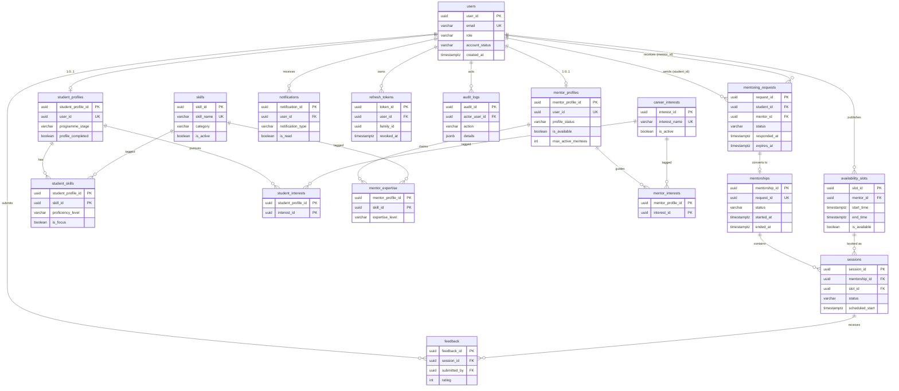
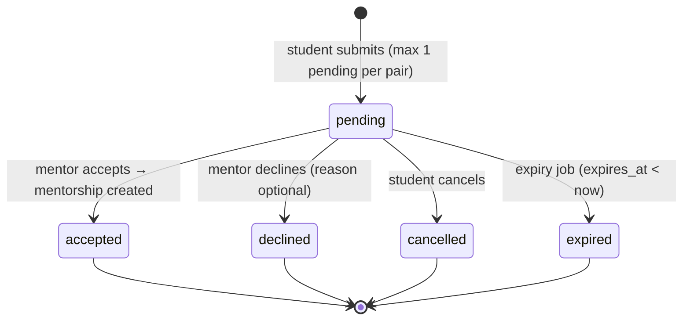
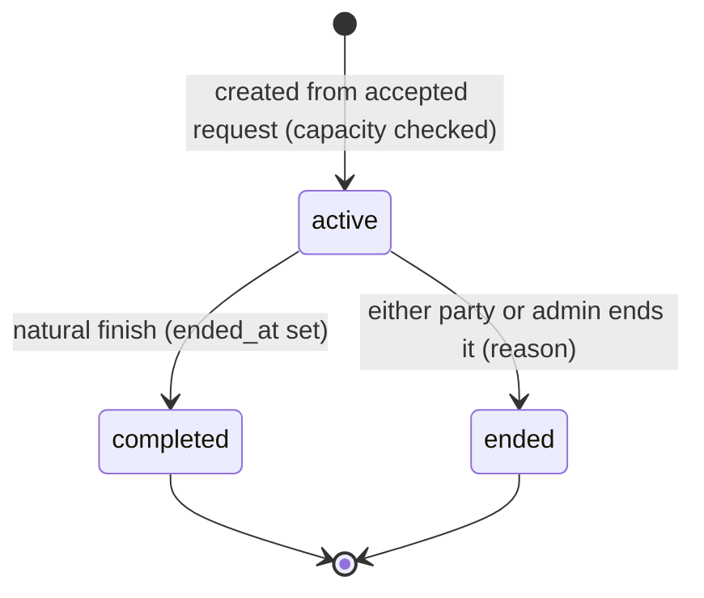
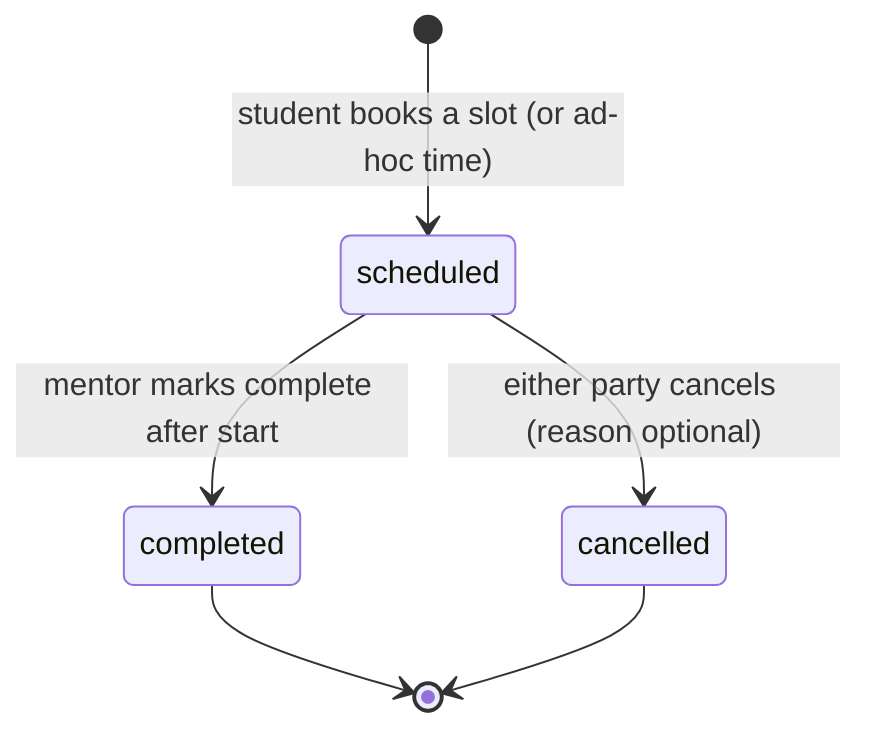
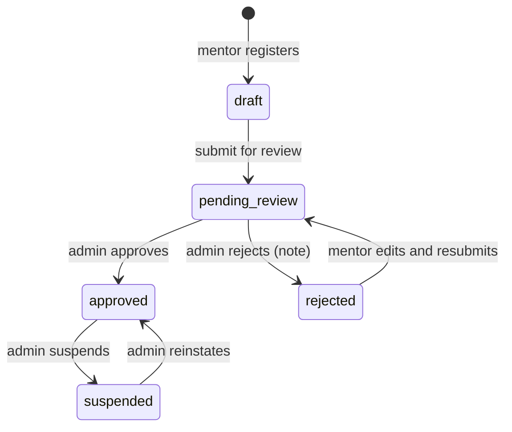

# Database Specification — IITM Mentoring Platform

**DBMS:** PostgreSQL 16 (15+ compatible) · **Schema:** 17 tables · **Source of truth:** `database/schema.sql`
**Companions:** [`DFD.md`](./DFD.md) (data flows) · [`CHARTS.md`](./CHARTS.md) (metrics + SQL) · [`README.md`](./README.md) (index)

---

## 1. What this document is for

This is a *semantic* description of the schema, not a copy of the DDL. The DDL says what is legal; this document says what each column **means**, how rows move through their lifecycle, and which relationships can be trusted when building a DFD or an analytics query.

Three consumers:

| Consumer | Reads | Produces |
| --- | --- | --- |
| DFD author / diagram tool | §4 entities, §5 join map, §6 relationships, `DFD.md` | Context diagram, level-1/2 flows, CRUD matrix |
| Chart builder / BI tool | §4 entities, §8 states, §10 volumes, `CHARTS.md` | Dashboards, exports, KPI cards |
| Application developer | Everything, especially §5 and §9 | Joins that don't silently drop rows |

**Hard rule:** when `schema.sql` changes, this document and the two companions change in the same PR. A column without a description is a review failure.

---

## 2. The domain in one page

The platform connects **students** at an Indian institute with **mentors** (alumni and recent graduates) for structured, time-boxed mentoring.

```
Student registers → completes profile (stage, goals, skills, interests)
      ↓
Discovers mentors (search + recommendation score)
      ↓
Sends a request (one pending request per mentor pair; expires in 14 days)
      ↓
Mentor accepts → a mentorship is created (capacity-limited)
      ↓
Mentor publishes availability slots → student books a session
      ↓
Session happens → mentor marks completed → both sides give 1–5 feedback
      ↓
Mentorship is completed or ended → history remains readable
```

An **administrator** approves mentor profiles before they become discoverable, can suspend accounts, curates the skill/interest catalogues, resolves stale requests, and reads programme analytics.

### Glossary

| Term | Meaning in this schema |
| --- | --- |
| **User** | Any authenticated person. One row in `users`; exactly one role. |
| **Student profile** | Role-specific data for a student. Created on onboarding, not at registration. |
| **Mentor profile** | Role-specific professional data. Has a review lifecycle before discovery. |
| **Skill / interest** | Catalogue entries. Skills are capabilities; interests are career pathways. |
| **Request** | A student's ask to a mentor. Terminal states: accepted, declined, cancelled, expired. |
| **Mentorship** | The relationship created from exactly one accepted request. |
| **Slot** | A mentor-published time window, maximum 4 hours, non-overlapping per mentor. |
| **Session** | A booked meeting inside a mentorship, optionally tied to a slot. |
| **Feedback** | One rating per participant per session (max two rows per session). |
| **Stale request** | A `pending` request older than 7 days (reporting definition, not a DB state). |

---

## 3. Design conventions

| Convention | Rule | Why |
| --- | --- | --- |
| Primary keys | `UUID DEFAULT gen_random_uuid()` | Opaque IDs safe to expose in URLs; no sequence contention. |
| Time | `TIMESTAMPTZ`, stored UTC, rendered in the viewer's zone | Sessions cross time zones; DST-safe arithmetic. |
| Enumerations | `VARCHAR` + named `CHECK`, never Postgres `ENUM` | Values visible in DDL; adding a value is a normal migration. |
| Naming | Tables plural `snake_case`; columns singular; constraints prefixed `ck_ / uq_ / ix_ / fk_ / ex_` | Grep-able, self-documenting errors. |
| Role integrity | Composite FKs on `(user_id, role)` | A student row cannot point at a mentor user, even by mistake. |
| Party integrity | Composite FKs carrying `(request_id, student_id, mentor_id)` forward | A mentorship cannot swap parties; a session cannot detach from its mentorship's pair. |
| Conditional uniqueness | **Partial unique indexes** (`WHERE status = 'pending'`) | "One pending request per pair" without blocking history. |
| Time overlap | `EXCLUDE USING gist (... WITH &&)` + `btree_gist` | The database, not the service, is the final arbiter on double-booking. |
| Soft lifecycle | Status columns + `anonymised_at`; no hard delete of people | History and analytics survive account closure. |
| Audit | `audit_logs` is append-only for the app role | Evidence trail for admin actions. |
| Derivation | `updated_at` by trigger; capacity/response invariants by trigger | Defence in depth behind the service layer. |

---

## 4. Entity catalogue

Data-store IDs (`D1`…`D17`) are reused in `DFD.md` so diagrams and prose share one vocabulary.

---

### D1 · `users`

**Purpose.** Identity anchor for every person. Holds credentials, role and account lifecycle only — no profile data.
**Written by.** P1 (registration, status changes by admin), P10 (suspend/reactivate).
**Read by.** Every process; it is the join hub of the schema.
**Lifecycle.** Created at registration (`account_status='active'`, `email_verified=false`). Suspended ↔ active by admin. Deactivated is terminal for login. Never hard-deleted while profiles exist; `anonymised_at` marks scrubbed rows.
**Volume.** 1 row per person; ~1,000 students + ~120 mentors per annual cohort.

| Column | Type | Null | Default | Rules | Meaning | Example |
| --- | --- | --- | --- | --- | --- | --- |
| `user_id` | UUID | no | `gen_random_uuid()` | PK | Surrogate identity; referenced everywhere as `student_id` / `mentor_id`. | `3f2a…` |
| `full_name` | VARCHAR(120) | no | — | `ck`: non-empty after trim | Display name. | `Asha Menon` |
| `email` | VARCHAR(255) | no | — | UNIQUE; `ck`: `email = lower(email)` | Login identity. Case-normalised at write time. | `asha.menon@example.org` |
| `password_hash` | VARCHAR(255) | no | — | — | Argon2/bcrypt hash. Never selected by list endpoints. | `$argon2id$…` |
| `role` | VARCHAR(20) | no | — | `ck`: `student\|mentor\|admin` | Authorisation role and profile discriminator. | `student` |
| `account_status` | VARCHAR(20) | no | `'active'` | `ck`: `active\|suspended\|deactivated` | Login gate. Suspended users authenticate but are refused at authorisation. | `active` |
| `email_verified` | BOOLEAN | no | `FALSE` | — | Whether the verification link was used. | `true` |
| `last_login_at` | TIMESTAMPTZ | yes | — | — | Last successful login; drives "inactive users" reports. | `2026-10-30 07:12+00` |
| `anonymised_at` | TIMESTAMPTZ | yes | — | — | Set when PII is scrubbed. Row remains for FK/audit integrity. | `NULL` |
| `created_at` | TIMESTAMPTZ | no | `now()` | — | Registration timestamp; x-axis for growth charts. | `2026-10-01 09:31+00` |
| `updated_at` | TIMESTAMPTZ | no | `now()` | trigger | Last mutation. | `2026-10-15 03:03+00` |

**Keys & indexes.** PK `(user_id)`; UNIQUE `(email)`; UNIQUE `(user_id, role)` — the target of composite role FKs; `ix_users_role_status (role, account_status)` for admin lists and role-mix charts.

**Relationships.** 1:0..1 → `student_profiles`, `mentor_profiles` (RESTRICT); 1:N → `notifications`, `refresh_tokens` (CASCADE); 1:N → `audit_logs`, `mentorships.ended_by`, `sessions.cancelled_by`, `mentor_profiles.reviewed_by` (SET NULL); 1:N → `feedback.submitted_by` (RESTRICT).

---

### D2 · `student_profiles`

**Purpose.** Everything the matching engine and mentors need to know about a student beyond identity.
**Written by.** P2 (onboarding, edits).
**Read by.** P2, P4 (matching), P10 (reporting), mentors viewing a request.
**Lifecycle.** Created empty-ish at onboarding; `profile_completed` flips when the required fields and at least one skill/interest exist. One row per student, enforced by `UNIQUE(user_id)`.
**Volume.** 1 per student (~1,000/cohort).

| Column | Type | Null | Default | Rules | Meaning | Example |
| --- | --- | --- | --- | --- | --- | --- |
| `student_profile_id` | UUID | no | `gen_random_uuid()` | PK | Surrogate key used by skill/interest link tables. | `a1b2…` |
| `user_id` | UUID | no | — | UNIQUE; FK → `users` RESTRICT | Owning user. | `3f2a…` |
| `user_role` | VARCHAR(20) | no | `'student'` | `ck = 'student'`; part of composite FK | Redundant by design: lets the DB reject a mentor user. | `student` |
| `programme_stage` | VARCHAR(50) | yes | — | `ck`: `foundation\|diploma\|bsc_degree\|bs_degree` | Academic stage; a matching filter. | `bsc_degree` |
| `expected_graduation_year` | INTEGER | yes | — | `ck`: 2024–2100 | Graduation cohort. | `2027` |
| `career_goals` | TEXT | yes | — | `ck`: ≤ 2000 chars | Free-text goal; shown to mentors and scanned by FTS/matching. | `Build a data engineering portfolio…` |
| `guidance_needs` | TEXT | yes | — | `ck`: ≤ 2000 chars | What help is wanted; matching signal. | `Project reviews, interview practice.` |
| `bio` | TEXT | yes | — | `ck`: ≤ 1000 chars | Short self-description. | `Second-year student exploring analytics.` |
| `profile_completed` | BOOLEAN | no | `FALSE` | — | Onboarding gate and funnel stage. | `true` |
| `created_at` / `updated_at` | TIMESTAMPTZ | no | `now()` | trigger on update | Row timestamps. | — |

**Keys & indexes.** PK `(student_profile_id)`; UNIQUE `(user_id)`; FK `(user_id, user_role)` → `users(user_id, role)`.

**Relationships.** N:1 → `users`; 1:N → `student_skills`, `student_interests` (CASCADE); 1:N → `mentoring_requests.student_id`, `mentorships.student_id` **via `user_id`, not `student_profile_id`**.

---

### D3 · `mentor_profiles`

**Purpose.** Professional identity, capacity and the admin review state that gates discovery.
**Written by.** P2 (mentor edits), P10 (approve/reject/suspend), trigger (capacity read).
**Read by.** P4 (discovery), P5 (eligibility/capacity), P10 (review queue, analytics).
**Lifecycle.** `draft → pending_review → approved | rejected`; `approved ⇄ suspended` by admin. Only `approved` mentors appear in discovery. `is_available` is the mentor-controlled "accepting mentees" switch, independent of review state.
**Volume.** ~1 per 8–10 students; 6 in the demo set.

| Column | Type | Null | Default | Rules | Meaning | Example |
| --- | --- | --- | --- | --- | --- | --- |
| `mentor_profile_id` | UUID | no | `gen_random_uuid()` | PK | Surrogate key for expertise/interests. | `b2c3…` |
| `user_id` | UUID | no | — | UNIQUE; FK → `users` RESTRICT | Owning user; also the `mentor_id` used in requests/sessions. | `9d8c…` |
| `user_role` | VARCHAR(20) | no | `'mentor'` | `ck = 'mentor'`; composite FK | Role guard. | `mentor` |
| `mentor_type` | VARCHAR(20) | no | `'alumni'` | `ck`: `recent_graduate\|alumni` | Segmentation for charts and copy. | `alumni` |
| `professional_title` | VARCHAR(120) | yes | — | required by `ck_mentor_complete` once out of draft/rejected | Job title. | `Senior Data Engineer` |
| `organisation` | VARCHAR(150) | yes | — | same | Employer. | `TechCorp` |
| `experience_years` | INTEGER | yes | — | `ck`: 0–60; completeness check | Years in industry. | `8` |
| `graduation_year` | INTEGER | yes | — | `ck`: 2000–2100 | Institute graduation year. | `2016` |
| `linkedin_url` | VARCHAR(255) | yes | — | — | External profile. | `https://linkedin.com/in/…` |
| `bio` | TEXT | yes | — | `ck`: ≤ 1500 chars; completeness check | Mentoring pitch. Indexed for full-text search. | `Building scalable data platforms…` |
| `is_available` | BOOLEAN | no | `TRUE` | — | Accepting new mentees. | `true` |
| `max_active_mentees` | INTEGER | no | `3` | `ck`: 1–10 | Capacity ceiling enforced by trigger. | `3` |
| `profile_status` | VARCHAR(20) | no | `'draft'` | `ck`: `draft\|pending_review\|approved\|rejected\|suspended` | Review lifecycle; gates discovery. | `approved` |
| `reviewed_by` | UUID | yes | — | FK → `users` SET NULL; required unless draft/pending | Admin who decided. | `admin_id` |
| `reviewed_at` | TIMESTAMPTZ | yes | — | — | Decision timestamp; review-latency chart. | `2026-10-20 11:00+00` |
| `review_note` | TEXT | yes | — | — | Reason shown to the mentor. | `Portfolio looks strong.` |
| `created_at` / `updated_at` | TIMESTAMPTZ | no | `now()` | trigger | Row timestamps. | — |

**Keys & indexes.** PK; UNIQUE `(user_id)`; `ix_mentor_discoverable (profile_status, is_available)` for the discovery query; GIN `ix_mentor_fts` over `professional_title || organisation || bio` for search.

**Constraints worth knowing.**
`ck_mentor_complete` — a profile can be `draft`/`rejected` while incomplete, but any other status requires title, organisation, experience and bio.
`ck_mentor_reviewed` — `approved`, `rejected`, `suspended` require `reviewed_by`.

**Relationships.** N:1 → `users`; 1:N → `mentor_expertise`, `mentor_interests` (CASCADE); 1:N → `mentoring_requests.mentor_id`, `mentorships.mentor_id`, `availability_slots.mentor_id` **via `user_id`**.

---

### D4 · `skills`

**Purpose.** Controlled vocabulary of capabilities, used on both sides of the marketplace.
**Written by.** P3 (admin catalogue).
**Read by.** P2, P4, P10.
**Lifecycle.** Created by admins; deactivated (`is_active=false`) rather than deleted so historical links survive.
**Volume.** 20 seeded; ~100 long-term.

| Column | Type | Null | Default | Rules | Meaning | Example |
| --- | --- | --- | --- | --- | --- | --- |
| `skill_id` | UUID | no | `gen_random_uuid()` | PK | — | `c3d4…` |
| `skill_name` | VARCHAR(100) | no | — | UNIQUE | Display name. | `Python` |
| `category` | VARCHAR(80) | yes | — | — | Grouping for filters/charts. | `Programming Languages` |
| `is_active` | BOOLEAN | no | `TRUE` | — | Hidden from pickers when false; links remain. | `true` |

**Relationships.** 1:N → `student_skills`, `mentor_expertise` (RESTRICT on delete).

---

### D5 · `career_interests`

**Purpose.** Controlled vocabulary of career pathways (Data Science, Product Management, …).
**Written by.** P3. **Read by.** P2, P4, P10.
**Lifecycle.** Same as skills: deactivate, never delete.
**Volume.** 15 seeded.

| Column | Type | Null | Default | Rules | Meaning | Example |
| --- | --- | --- | --- | --- | --- | --- |
| `interest_id` | UUID | no | `gen_random_uuid()` | PK | — | `d4e5…` |
| `interest_name` | VARCHAR(100) | no | — | UNIQUE | Display name. | `Data Science` |
| `description` | TEXT | yes | — | — | One-line explanation for the picker. | `Analytics, ML and statistical modelling` |
| `is_active` | BOOLEAN | no | `TRUE` | — | Soft retirement. | `true` |

**Relationships.** 1:N → `student_interests`, `mentor_interests` (RESTRICT).

---

### D6 · `student_skills`

**Purpose.** Many-to-many between students and skills, with proficiency and a "focus" flag.
**Written by.** P2. **Read by.** P4 (demand signal), P10 (skill-gap chart).
**Lifecycle.** Replaced wholesale when the student edits skills; cascade-deleted with the profile.
**Volume.** ~4 per student.

| Column | Type | Null | Default | Rules | Meaning |
| --- | --- | --- | --- | --- | --- |
| `student_profile_id` | UUID | no | — | PK part; FK CASCADE | Student. |
| `skill_id` | UUID | no | — | PK part; FK RESTRICT | Skill. |
| `proficiency_level` | VARCHAR(30) | no | — | `ck`: `beginner\|intermediate\|advanced\|expert` | Self-assessed level. |
| `is_focus` | BOOLEAN | no | `FALSE` | — | The 1–3 skills the student wants to work on; weighted heavily by matching and used as demand in charts. |

**Keys & indexes.** PK `(student_profile_id, skill_id)`; `ix_student_skills_skill (skill_id)` for supply/demand aggregation.

---

### D7 · `mentor_expertise`

**Purpose.** Many-to-many between mentors and skills, with an expertise level.
**Written by.** P2. **Read by.** P4 (supply signal), P10.
**Volume.** ~5 per mentor.

| Column | Type | Null | Default | Rules | Meaning |
| --- | --- | --- | --- | --- | --- |
| `mentor_profile_id` | UUID | no | — | PK part; FK CASCADE | Mentor. |
| `skill_id` | UUID | no | — | PK part; FK RESTRICT | Skill. |
| `expertise_level` | VARCHAR(30) | no | — | `ck`: `beginner\|intermediate\|advanced\|expert` | Claimed level; admin-reviewed via the profile. |

**Keys & indexes.** PK `(mentor_profile_id, skill_id)`; `ix_mentor_expertise_skill (skill_id, mentor_profile_id)` supports "mentors for this skill" without a heap scan.

---

### D8 · `student_interests`

**Purpose.** Many-to-many student ↔ career interest.
**Written by.** P2. **Read by.** P4, P10.
**Volume.** ~2 per student.

| Column | Type | Null | Default | Rules |
| --- | --- | --- | --- | --- |
| `student_profile_id` | UUID | no | — | PK part; FK CASCADE |
| `interest_id` | UUID | no | — | PK part; FK RESTRICT |

**Keys & indexes.** PK `(student_profile_id, interest_id)`; `ix_student_interests_interest`.

---

### D9 · `mentor_interests`

**Purpose.** Many-to-many mentor ↔ career interest; used in recommendation scoring.
**Written by.** P2. **Read by.** P4, P10.
**Volume.** ~2 per mentor.

| Column | Type | Null | Default | Rules |
| --- | --- | --- | --- | --- |
| `mentor_profile_id` | UUID | no | — | PK part; FK CASCADE |
| `interest_id` | UUID | no | — | PK part; FK RESTRICT |

**Keys & indexes.** PK `(mentor_profile_id, interest_id)`; `ix_mentor_interests_interest`.

---

### D10 · `mentoring_requests`

**Purpose.** The transactional heart: a student asks a mentor for mentoring, with an expiry clock.
**Written by.** P5 (create/decide/cancel), P11 (expiry job), P10 (admin cancellation).
**Read by.** P5, P6, P10; both dashboards.
**Lifecycle.** `pending → accepted | declined | cancelled | expired`. A decided request requires `responded_at`; acceptance is the only path that creates a mentorship. Re-requesting after expiry/decline is allowed; a second *pending* request for the same pair is not.
**Volume.** ~0.6 per student per cycle; 3 in the demo set.

| Column | Type | Null | Default | Rules | Meaning | Example |
| --- | --- | --- | --- | --- | --- | --- |
| `request_id` | UUID | no | `gen_random_uuid()` | PK | — | `e5f6…` |
| `student_id` | UUID | no | — | FK → `student_profiles(user_id)` RESTRICT | **User ID**, not `student_profile_id`. | `3f2a…` |
| `mentor_id` | UUID | no | — | FK → `mentor_profiles(user_id)` RESTRICT | **User ID**. | `9d8c…` |
| `career_goal` | TEXT | no | — | `ck`: length 20–1000 | What the student wants; the main decision input. | `Transition into a data engineering role…` |
| `message` | TEXT | yes | — | `ck`: ≤ 1500 | Optional pitch. | `I admire your work…` |
| `status` | VARCHAR(20) | no | `'pending'` | `ck`: `pending\|accepted\|declined\|cancelled\|expired` | Current state. | `pending` |
| `status_reason` | TEXT | yes | — | — | Decline/cancel explanation. | `At capacity this month.` |
| `created_at` | TIMESTAMPTZ | no | `now()` | — | Start of the response clock. | `2026-10-15 03:03+00` |
| `responded_at` | TIMESTAMPTZ | yes | — | `ck_request_responded`: set iff accepted/declined | Mentor decision timestamp. | `NULL` |
| `expires_at` | TIMESTAMPTZ | no | `now() + 14 days` | — | Expiry deadline; job flips pending rows. | `2026-10-29 03:03+00` |
| `updated_at` | TIMESTAMPTZ | no | `now()` | trigger | — | — |

**Keys & indexes.**
`uq_request_parties (request_id, student_id, mentor_id)` — target for the composite FK from `mentorships`.
`uq_pending_request (student_id, mentor_id) WHERE status='pending'` — one open ask per pair.
`ix_requests_mentor (mentor_id, status, created_at DESC)` — mentor inbox.
`ix_requests_student (student_id, status, created_at DESC)` — student list.
`ix_requests_expiry (expires_at) WHERE status='pending'` — the expiry job's index.

**Constraint interplay.** `ck_request_responded` makes it impossible to record an outcome without a timestamp, and impossible to timestamp a pending request.

---

### D11 · `mentorships`

**Purpose.** The durable relationship created from an accepted request. Capacity, sessions and feedback hang off it.
**Written by.** P6 (create on accept, end/complete), P10 (admin end).
**Read by.** P6, P7, P8, P10.
**Lifecycle.** Created `active` with `started_at`; ends as `completed` (natural finish) or `ended` (either party/admin, with reason). `ended_at` is mandatory for both terminal states. Exactly one mentorship per request (`UNIQUE(request_id)`), and at most one active mentorship per pair.
**Volume.** ~35% of requests convert; 2 in the demo set.

| Column | Type | Null | Default | Rules | Meaning |
| --- | --- | --- | --- | --- | --- |
| `mentorship_id` | UUID | no | `gen_random_uuid()` | PK | — |
| `request_id` | UUID | no | — | UNIQUE; FK RESTRICT | The accepted request. |
| `student_id` / `mentor_id` | UUID | no | — | composite FK → request parties | Must match the request exactly. |
| `status` | VARCHAR(20) | no | `'active'` | `ck`: `active\|completed\|ended` | Lifecycle state. |
| `started_at` | TIMESTAMPTZ | no | `now()` | — | Start of the relationship. |
| `ended_at` | TIMESTAMPTZ | yes | — | `ck_mentorship_ended`: null iff active | End timestamp. |
| `ended_by` | UUID | yes | — | FK → `users` SET NULL | Who ended it (null for natural completion). |
| `end_reason` | TEXT | yes | — | — | Why. |
| `created_at` / `updated_at` | TIMESTAMPTZ | no | `now()` | trigger | — |

**Keys & indexes.** PK; UNIQUE `(request_id)`; UNIQUE `(mentorship_id, student_id, mentor_id)` (target for sessions); `uq_active_pair (student_id, mentor_id) WHERE status='active'`; `ix_mentorship_mentor`, `ix_mentorship_student`.

**Triggers.**
`trg_mentorship_requires_accepted` — insert fails unless the request is `accepted`.
`trg_mentorship_capacity` — insert fails if active count ≥ `max_active_mentees` (service takes `FOR UPDATE` first; trigger is the safety net).

---

### D12 · `availability_slots`

**Purpose.** Mentor-published windows that students can book.
**Written by.** P7 (create single/recurring, edit, delete).
**Read by.** P4 (availability hint), P7 (booking), P10.
**Lifecycle.** Slots are future windows; `is_available=false` hides one without deleting. A slot with a `scheduled` session is effectively consumed (derived, not stored).
**Volume.** ~4–10 open slots per active mentor per fortnight; 20 in the demo set.

| Column | Type | Null | Default | Rules | Meaning |
| --- | --- | --- | --- | --- | --- |
| `slot_id` | UUID | no | `gen_random_uuid()` | PK | — |
| `mentor_id` | UUID | no | — | FK → `mentor_profiles(user_id)` RESTRICT | **User ID**. |
| `start_time` / `end_time` | TIMESTAMPTZ | no | — | `ck`: end > start and duration ≤ 4 h | The bookable window. |
| `is_available` | BOOLEAN | no | `TRUE` | — | Mentor's manual switch. Bookability = available AND not held by a scheduled session. |
| `created_at` | TIMESTAMPTZ | no | `now()` | — | — |

**Keys & indexes.** PK; `ex_slot_no_overlap` — `EXCLUDE (mentor_id WITH =, tstzrange(start_time, end_time) WITH &&)` prevents overlapping slots per mentor; `ix_slots_open (mentor_id, start_time) WHERE is_available`.

**Booking invariant (derived).** A slot is held when `EXISTS (SELECT 1 FROM sessions WHERE slot_id = s.slot_id AND status='scheduled')`; enforced by `uq_session_slot_booked`.

---

### D13 · `sessions`

**Purpose.** A concrete meeting inside a mentorship.
**Written by.** P7 (book, cancel, complete, notes), P8 (feedback reads).
**Read by.** P7, P8, P10; both dashboards.
**Lifecycle.** `scheduled → completed | cancelled`. Completion only by the mentor and only after the start time (service rule). Cancellation records who and why. A session can exist without a slot (ad-hoc booking).
**Volume.** ~4 per mentorship.

| Column | Type | Null | Default | Rules | Meaning |
| --- | --- | --- | --- | --- | --- |
| `session_id` | UUID | no | `gen_random_uuid()` | PK | — |
| `mentorship_id` | UUID | no | — | FK RESTRICT | Parent relationship. |
| `student_id` / `mentor_id` | UUID | no | — | composite FK → mentorship parties | Denormalised for overlap constraints and fast dashboards; guaranteed consistent. |
| `slot_id` | UUID | yes | — | FK → slots SET NULL | Source slot, if booked from one. |
| `scheduled_start` / `scheduled_end` | TIMESTAMPTZ | no | — | `ck`: end > start | Meeting window. |
| `meeting_mode` | VARCHAR(20) | no | `'online'` | `ck`: `online\|phone\|in_person` | Channel. |
| `meeting_link` | TEXT | yes | — | — | URL for online sessions. |
| `status` | VARCHAR(20) | no | `'scheduled'` | `ck`: `scheduled\|completed\|cancelled` | State. |
| `notes` | TEXT | yes | — | `ck`: ≤ 4000 | Mentor's session notes. |
| `cancelled_by` | UUID | yes | — | FK → `users` SET NULL | Who cancelled. |
| `cancel_reason` | TEXT | yes | — | `ck_session_cancel`: null unless cancelled | Why. |
| `created_at` / `updated_at` | TIMESTAMPTZ | no | `now()` | trigger | — |

**Keys & indexes.**
`ex_session_mentor_no_overlap` and `ex_session_student_no_overlap` — partial GiST exclusion on scheduled sessions only, so cancelled history never blocks a rebooking.
`uq_session_slot_booked (slot_id) WHERE status='scheduled'` — one live booking per slot.
`ix_sessions_mentorship`, `ix_sessions_mentor_time`, `ix_sessions_student_time`.

---

### D14 · `feedback`

**Purpose.** Post-session rating and comment from each participant.
**Written by.** P8 only.
**Read by.** P8, P10, mentor profile ratings.
**Lifecycle.** Created once per `(session, submitter)`; immutable in practice (no update endpoint). Two rows per session maximum — one student, one mentor.
**Volume.** ~1.5 per completed session (not every session gets both sides).

| Column | Type | Null | Default | Rules | Meaning |
| --- | --- | --- | --- | --- | --- |
| `feedback_id` | UUID | no | `gen_random_uuid()` | PK | — |
| `session_id` | UUID | no | — | FK RESTRICT | Reviewed session. |
| `submitted_by` | UUID | no | — | FK → `users` RESTRICT | Must be the session's student or mentor (service rule, not DB). |
| `rating` | INTEGER | no | — | `ck`: 1–5 | Star rating. |
| `comments` | TEXT | yes | — | `ck`: ≤ 1000 | Optional text. |
| `created_at` | TIMESTAMPTZ | no | `now()` | — | Submission time. |

**Keys & indexes.** PK; `uq_feedback_once (session_id, submitted_by)`.

---

### D15 · `notifications`

**Purpose.** In-app event log per user; the bell and the notifications pages read from here.
**Written by.** P5, P6, P7, P8, P10 (via `notification_service`), P11 (jobs).
**Read by.** P9 (list/mark read), both dashboards.
**Lifecycle.** Created unread; `is_read`/`read_at` flip together. Never updated otherwise. Cascades with the user.
**Volume.** ~15–20 per active user per cycle.

| Column | Type | Null | Default | Rules | Meaning |
| --- | --- | --- | --- | --- | --- |
| `notification_id` | UUID | no | `gen_random_uuid()` | PK | — |
| `user_id` | UUID | no | — | FK CASCADE | Recipient. |
| `title` | VARCHAR(150) | no | — | — | Short headline. |
| `message` | TEXT | no | — | — | Body. |
| `notification_type` | VARCHAR(50) | no | — | `ck`: 12 values (see §7) | Event taxonomy; drives icons and analytics. |
| `related_entity_type` | VARCHAR(50) | yes | — | — | Polymorphic hint (`mentoring_request`, `session`, …). No FK by design. |
| `related_entity_id` | UUID | yes | — | — | Target for deep links. |
| `is_read` | BOOLEAN | no | `FALSE` | `ck_notification_read`: matches `read_at` | Read flag. |
| `read_at` | TIMESTAMPTZ | yes | — | — | When read. |
| `created_at` | TIMESTAMPTZ | no | `now()` | — | Event time. |

**Keys & indexes.** PK; `ix_notifications_user (user_id, is_read, created_at DESC)` — serves both the unread badge and the paginated list.

---

### D16 · `audit_logs`

**Purpose.** Append-only evidence of privileged or state-changing actions.
**Written by.** P1, P2, P5, P6, P7, P10.
**Read by.** P10 (audit page), compliance exports.
**Lifecycle.** Insert-only; retention policy is operational (recommend 24 months). Actor may become null when a user row is deleted/anonymised.
**Volume.** ~1 per state change; ~10 per request lifecycle.

| Column | Type | Null | Default | Rules | Meaning |
| --- | --- | --- | --- | --- | --- |
| `audit_id` | UUID | no | `gen_random_uuid()` | PK | — |
| `actor_user_id` | UUID | yes | — | FK SET NULL | Who acted; null for system jobs. |
| `action` | VARCHAR(100) | no | — | — | Verb, e.g. `mentor.approved`, `request.declined`. |
| `entity_type` | VARCHAR(50) | no | — | — | Affected entity. |
| `entity_id` | UUID | no | — | — | Affected row. |
| `details` | JSONB | yes | — | — | Before/after or context payload. |
| `ip_address` | INET | yes | — | — | Source address for admin actions. |
| `created_at` | TIMESTAMPTZ | no | `now()` | — | Event time. |

**Keys & indexes.** `ix_audit_entity (entity_type, entity_id)`, `ix_audit_actor (actor_user_id, created_at DESC)`, `ix_audit_time (created_at)`.

---

### D17 · `refresh_tokens`

**Purpose.** Rotating refresh-token families for session continuity and reuse detection.
**Written by.** P1 (issue, rotate, revoke).
**Read by.** P1 only.
**Lifecycle.** Issued on login; rotated on refresh (old row `revoked_reason='rotated'`); revoked on logout/password change; a reused rotated token revokes the whole family (`reuse_detected`). Expired rows are prunable.
**Volume.** ~2–5 per active user per month.

| Column | Type | Null | Default | Rules | Meaning |
| --- | --- | --- | --- | --- | --- |
| `token_id` | UUID | no | `gen_random_uuid()` | PK | — |
| `user_id` | UUID | no | — | FK CASCADE | Owner. |
| `family_id` | UUID | no | — | indexed | Groups a rotation chain. |
| `token_hash` | CHAR(64) | no | — | UNIQUE | SHA-256 hex of the token; plaintext never stored. |
| `issued_at` | TIMESTAMPTZ | no | `now()` | — | Issue time. |
| `expires_at` | TIMESTAMPTZ | no | — | `ck`: > issued_at | Expiry. |
| `revoked_at` | TIMESTAMPTZ | yes | — | `ck_token_revoked`: matches reason | Revocation time. |
| `revoked_reason` | VARCHAR(30) | yes | — | `ck`: `rotated\|logout\|reuse_detected\|password_change\|admin_action` | Why. |

**Keys & indexes.** PK; UNIQUE `(token_hash)`; `ix_refresh_user_live (user_id) WHERE revoked_at IS NULL`; `ix_refresh_family (family_id)`.

---

## 5. Join map — read this before writing any query

The schema deliberately references **`user_id` values** from the profile tables in transactional tables. Joining `mentoring_requests.student_id` to `student_profiles.student_profile_id` returns zero rows and is the most common mistake in this codebase.

| Child column | Joins to | On | Cardinality | Note |
| --- | --- | --- | --- | --- |
| `student_profiles.user_id` | `users.user_id` | `=` | N:1 | Also composite `(user_id, user_role)` |
| `mentor_profiles.user_id` | `users.user_id` | `=` | N:1 | Also composite |
| `mentoring_requests.student_id` | `student_profiles.user_id` | `=` | N:1 | **not** `student_profile_id` |
| `mentoring_requests.mentor_id` | `mentor_profiles.user_id` | `=` | N:1 | **not** `mentor_profile_id` |
| `mentorships.student_id` / `mentor_id` | request's parties | composite | 1:1 per request | Carried forward for integrity |
| `sessions.student_id` / `mentor_id` | mentorship's parties | composite | N:1 | Carried forward |
| `sessions.slot_id` | `availability_slots.slot_id` | `=` | N:0..1 | Nullable |
| `feedback.session_id` | `sessions.session_id` | `=` | N:1 | Unique per submitter |
| `feedback.submitted_by` | `users.user_id` | `=` | N:1 | Participant check in service |
| `notifications.user_id` | `users.user_id` | `=` | N:1 | |
| `audit_logs.actor_user_id` | `users.user_id` | `=` | N:0..1 | Nullable |
| `mentor_profiles.reviewed_by` | `users.user_id` | `=` | N:0..1 | Nullable |
| `mentorships.ended_by` | `users.user_id` | `=` | N:0..1 | Nullable |
| `sessions.cancelled_by` | `users.user_id` | `=` | N:0..1 | Nullable |
| `refresh_tokens.user_id` | `users.user_id` | `=` | N:1 | |

**Canonical display join** (use this in lists):

```sql
SELECT r.request_id, su.full_name AS student_name, mu.full_name AS mentor_name, r.status
FROM mentoring_requests r
JOIN users su ON su.user_id = r.student_id
JOIN users mu ON mu.user_id = r.mentor_id;
```

Joining through the profile tables is only needed when you want profile fields (stage, title, capacity):

```sql
SELECT r.request_id, sp.programme_stage, mp.professional_title
FROM mentoring_requests r
JOIN student_profiles sp ON sp.user_id = r.student_id
JOIN mentor_profiles  mp ON mp.user_id = r.mentor_id;
```

---

## 6. Relationship matrix

| # | Parent | Child | Cardinality | Optional child? | On delete |
| --- | --- | --- | --- | --- | --- |
| 1 | `users` | `student_profiles` | 1 : 0..1 | yes | RESTRICT |
| 2 | `users` | `mentor_profiles` | 1 : 0..1 | yes | RESTRICT |
| 3 | `users` | `mentor_profiles.reviewed_by` | 1 : N | yes | SET NULL |
| 4 | `users` | `mentoring_requests` (as student) | 1 : N | no | RESTRICT |
| 5 | `users` | `mentoring_requests` (as mentor) | 1 : N | no | RESTRICT |
| 6 | `mentoring_requests` | `mentorships` | 1 : 0..1 | yes | RESTRICT |
| 7 | `mentorships` | `sessions` | 1 : N | yes | RESTRICT |
| 8 | `users` | `availability_slots` | 1 : N | yes | RESTRICT |
| 9 | `availability_slots` | `sessions.slot_id` | 1 : 0..N | yes | SET NULL |
| 10 | `sessions` | `feedback` | 1 : 0..2 | yes | RESTRICT |
| 11 | `users` | `feedback.submitted_by` | 1 : N | no | RESTRICT |
| 12 | `users` | `notifications` | 1 : N | yes | CASCADE |
| 13 | `users` | `refresh_tokens` | 1 : N | yes | CASCADE |
| 14 | `users` | `audit_logs.actor_user_id` | 1 : N | yes | SET NULL |
| 15 | `users` | `mentorships.ended_by` | 1 : N | yes | SET NULL |
| 16 | `users` | `sessions.cancelled_by` | 1 : N | yes | SET NULL |
| 17 | `student_profiles` | `student_skills` | 1 : N | no | CASCADE |
| 18 | `skills` | `student_skills` | 1 : N | no | RESTRICT |
| 19 | `mentor_profiles` | `mentor_expertise` | 1 : N | no | CASCADE |
| 20 | `skills` | `mentor_expertise` | 1 : N | no | RESTRICT |
| 21 | `student_profiles` | `student_interests` | 1 : N | no | CASCADE |
| 22 | `career_interests` | `student_interests` | 1 : N | no | RESTRICT |
| 23 | `mentor_profiles` | `mentor_interests` | 1 : N | no | CASCADE |
| 24 | `career_interests` | `mentor_interests` | 1 : N | no | RESTRICT |

### Full ERD



---

## 7. Enumerations (single source for filters and chart labels)

| Table.column | Allowed values | Default | Notes |
| --- | --- | --- | --- |
| `users.role` | `student`, `mentor`, `admin` | — | Immutable after registration. |
| `users.account_status` | `active`, `suspended`, `deactivated` | `active` | Suspended can log in but is refused by authorisation in the product rules. |
| `student_profiles.programme_stage` | `foundation`, `diploma`, `bsc_degree`, `bs_degree` | — | Optional until onboarding completes. |
| `mentor_profiles.mentor_type` | `recent_graduate`, `alumni` | `alumni` | |
| `mentor_profiles.profile_status` | `draft`, `pending_review`, `approved`, `rejected`, `suspended` | `draft` | Only `approved` is discoverable. |
| `student_skills.proficiency_level` | `beginner`, `intermediate`, `advanced`, `expert` | — | |
| `mentor_expertise.expertise_level` | `beginner`, `intermediate`, `advanced`, `expert` | — | |
| `mentoring_requests.status` | `pending`, `accepted`, `declined`, `cancelled`, `expired` | `pending` | Terminal except pending. |
| `mentorships.status` | `active`, `completed`, `ended` | `active` | |
| `sessions.meeting_mode` | `online`, `phone`, `in_person` | `online` | |
| `sessions.status` | `scheduled`, `completed`, `cancelled` | `scheduled` | |
| `notifications.notification_type` | `request_received`, `request_accepted`, `request_declined`, `request_cancelled`, `request_expired`, `mentorship_ended`, `session_scheduled`, `session_cancelled`, `session_reminder`, `feedback_requested`, `mentor_reviewed`, `account_status_changed` | — | Twelve event types. |
| `refresh_tokens.revoked_reason` | `rotated`, `logout`, `reuse_detected`, `password_change`, `admin_action` | — | Null iff not revoked. |

---

## 8. State machines

### 8.1 Request



| Transition | Actor | DB effect | Notification emitted |
| --- | --- | --- | --- |
| create | Student | insert `status='pending'`, `expires_at=now()+14d` | `request_received` → mentor |
| accept | Mentor | `status='accepted'`, `responded_at=now()`; insert mentorship in the same transaction | `request_accepted` → student |
| decline | Mentor | `status='declined'`, `responded_at=now()`, optional reason | `request_declined` → student |
| cancel | Student | `status='cancelled'`, optional reason | `request_cancelled` → mentor |
| expire | Job (P11) | `status='expired'` | `request_expired` → student |

### 8.2 Mentorship



| Transition | Actor | DB effect | Notification |
| --- | --- | --- | --- |
| complete | Student or mentor | `status='completed'`, `ended_at=now()` | `mentorship_ended` → counterpart |
| end | Student, mentor or admin | `status='ended'`, `ended_at`, `ended_by`, `end_reason` | `mentorship_ended` → counterpart |

### 8.3 Session



| Transition | Actor | DB effect | Notification |
| --- | --- | --- | --- |
| book | Student | insert `status='scheduled'`; overlap + slot-hold checks | `session_scheduled` → mentor |
| complete | Mentor (after start) | `status='completed'`, notes optional | `feedback_requested` → student |
| cancel | Student or mentor | `status='cancelled'`, `cancelled_by`, reason | `session_cancelled` → counterpart |

### 8.4 Mentor profile



### 8.5 Account

| From | To | Actor | Effect |
| --- | --- | --- | --- |
| active | suspended | Admin | Login blocked at authorisation; sessions may continue until token expiry. |
| suspended | active | Admin | Restored. |
| active / suspended | deactivated | Admin | Terminal for login; profile hidden from discovery. |

### 8.6 Notification

`unread (is_read=false, read_at=null) → read (is_read=true, read_at=now())`. No reverse transition; enforced by `ck_notification_read`.

---

## 9. Integrity invariants (what the database refuses)

| # | Invariant | Enforced by | Error surface |
| --- | --- | --- | --- |
| 1 | A user has exactly one role and profiles match it | composite FKs `(user_id, user_role)` | FK violation |
| 2 | A student cannot hold two pending requests to the same mentor | `uq_pending_request` (partial) | 23505 |
| 3 | A pair cannot have two active mentorships | `uq_active_pair` (partial) | 23505 |
| 4 | Accepted/declined ⇔ `responded_at` present | `ck_request_responded` | 23514 |
| 5 | Active mentorship ⇔ `ended_at` null | `ck_mentorship_ended` | 23514 |
| 6 | Cancellation fields only on cancelled sessions | `ck_session_cancel` | 23514 |
| 7 | Mentor slots never overlap | `ex_slot_no_overlap` (GiST) | 23P01 |
| 8 | A mentor/student is never double-booked on live sessions | `ex_session_*_no_overlap` (partial GiST) | 23P01 |
| 9 | A slot holds at most one scheduled session | `uq_session_slot_booked` (partial) | 23505 |
| 10 | A non-draft, non-rejected mentor profile is complete | `ck_mentor_complete` | 23514 |
| 11 | Approved/rejected/suspended profiles have a reviewer | `ck_mentor_reviewed` | 23514 |
| 12 | Mentorship only from an accepted request | trigger `trg_mentorship_requires_accepted` | 23514 |
| 13 | Mentor capacity is never exceeded | trigger `trg_mentorship_capacity` + service lock | 23514 |
| 14 | One feedback per participant per session | `uq_feedback_once` | 23505 |
| 15 | Read flag and read timestamp agree | `ck_notification_read` | 23514 |
| 16 | Revocation timestamp and reason agree | `ck_token_revoked` | 23514 |
| 17 | Ratings are 1–5; sessions and slots have positive duration | `CHECK` constraints | 23514 |
| 18 | `updated_at` always reflects the last write | `set_updated_at` triggers | — |

---

## 10. Volume model (for chart expectations and index sizing)

Planning assumptions per **1,000 registered students** per annual cycle:

| Entity | Multiplier | Rows | Notes |
| --- | --- | --- | --- |
| `users` (students) | 1.0 | 1,000 | |
| `users` (mentors) | 0.12 | 120 | ~1 mentor per 8 students |
| `student_profiles` | 1.0 | 1,000 | ~70% complete onboarding |
| `mentor_profiles` | 0.12 | 120 | ~80% approved at any time |
| `student_skills` | 4.0 | 4,000 | 1–3 focus skills each |
| `mentor_expertise` | 5.0 | 600 | |
| `student_interests` | 2.0 | 2,000 | |
| `mentor_interests` | 2.0 | 240 | |
| `mentoring_requests` | 0.6 | 600 | ~55% accepted, 20% declined, 15% expired, 10% cancelled |
| `mentorships` | 0.33 | 200 | one per accepted request |
| `availability_slots` | 12 per mentor/cycle | ~1,440 | weekly recurrence expands to rows |
| `sessions` | 4 per mentorship | 800 | ~75% completed, 15% cancelled, 10% upcoming |
| `feedback` | 1.5 per completed session | ~900 | both sides not guaranteed |
| `notifications` | 20 per user | ~22,000 | largest table by row count |
| `audit_logs` | ~8 per request | ~5,000 | append-only |
| `refresh_tokens` | 3 per active user/month | ~3,000 | prunable after expiry |

Demo dataset (fresh seed): **10 users** (1 admin, 3 students, 6 mentors), 6 mentor profiles (5 approved, 1 pending), 3 requests (2 accepted, 1 pending at seed time), 2 active mentorships, 1 completed session, 2 feedback rows, 20 availability slots, 0 notifications until first login/action.

The live Neon `production` branch has drifted through manual testing: **11 users** (1 admin, 6 mentors, 4 students), 4 accepted + 1 pending requests, 4 active mentorships, 1 completed + 1 cancelled session, 6 approved mentor profiles, 7 notifications, 16 slots (15 available) as of 31 Oct 2026. Chart expectations for both datasets are listed in `CHARTS.md` §6.

---

## 11. Lifecycle, retention and deletion

| Concern | Behaviour |
| --- | --- |
| Account closure | `users.anonymised_at` is set and PII is replaced; the row stays so FKs and historical aggregates remain valid. `profile_status` / `account_status` hide the person from discovery. |
| Hard deletes | Not exposed for people. Catalogue entries are deactivated (`is_active=false`), not deleted. |
| Cascades | Deleting a user removes `notifications` and `refresh_tokens`; profile link rows cascade from profiles. Transactional history is protected by RESTRICT. |
| Audit retention | Recommended 24 months hot, then archive to object storage; `audit_logs` is append-only for the app role. |
| Refresh tokens | Expired/revoked rows are safe to purge after 90 days; live rows are found by the partial index. |
| Notifications | Safe to purge read rows after 12 months; unread rows are user-visible and must be kept. |
| Sessions | Never deleted; cancellation is a status, not a delete, so analytics stay honest. |
| Time zone | All timestamps UTC. Display conversion happens in the client. Analytics buckets default to UTC; use `AT TIME ZONE 'Asia/Kolkata'` when a dashboard needs programme-local days. |

---

## 12. Known modelling decisions (and why)

| Decision | Alternative rejected | Reason |
| --- | --- | --- |
| Transactional tables store `user_id`, not profile IDs | FK to `student_profile_id` | One identity across roles; profile rows can be recreated without rewriting history. |
| `sessions` duplicates `student_id`/`mentor_id` | Join through `mentorship_id` only | Needed for GiST exclusion constraints and fast "my schedule" queries; composite FK keeps it honest. |
| Status as `VARCHAR + CHECK` | Native `ENUM` | Easier migrations, readable DDL, no type casts in queries. |
| No FK on `(related_entity_type, related_entity_id)` | Polymorphic FK | Postgres cannot express it; notifications are ephemeral and tolerate dangling links. |
| Notifications are rows, not a queue | External broker | In-app notifications are product data; email delivery is out of scope for this schema. |
| `feedback` allows two rows per session | One aggregate row | Each side rates independently; anonymity of one side is preserved. |
| No soft-delete column on most tables | `deleted_at` everywhere | Status columns already express lifecycle; hiding is role/status logic. |
| Audit actor nullable | NOT NULL actor | System jobs (expiry, reminders) act without a human. |

---

## 13. How to regenerate the diagrams

```bash
# Mermaid blocks in this file and DFD.md
npx -y @mermaid-js/mermaid-cli -i DATABASE-SPEC.md -o /tmp/spec.md   # extracts? no — use blocks individually
```

Mermaid CLI renders one diagram per input file. Extract a block, then:

```bash
npx -y @mermaid-js/mermaid-cli -i erd.mmd -o erd.png -w 2400 -b white
```

For a live, editable ERD, import `database/schema.sql` into [dbdiagram.io](https://dbdiagram.io) (SQL import) or DataGrip; the DDL is the only input needed.

---

*Companion documents: [`DFD.md`](./DFD.md) · [`CHARTS.md`](./CHARTS.md) · Last verified against `database/schema.sql` on 2026-10-31.*
