# Data Flow Diagrams — IITM Mentoring Platform

**Companion to:** [`DATABASE-SPEC.md`](./DATABASE-SPEC.md) · **Data stores:** D1–D17 (one per table)
**Notation:** external entity = rectangle · process = rounded rectangle · data store = cylinder · flow = labelled arrow

---

## 1. How to read this document

The DFD is split into a context diagram (level 0), eleven level-1 process diagrams, and two level-2 decompositions for the processes with real branching (requests and scheduling). Every arrow carries a flow ID (`F01`…) that appears in the flow catalogue in §7, so a diagram can be regenerated from the tables alone.

**Scope.** The platform's own data stores. Email delivery, the OAuth/identity provider and the browser are outside the system boundary; notifications are rows in D15 that a future delivery worker would read.

---

## 2. Level 0 — context diagram

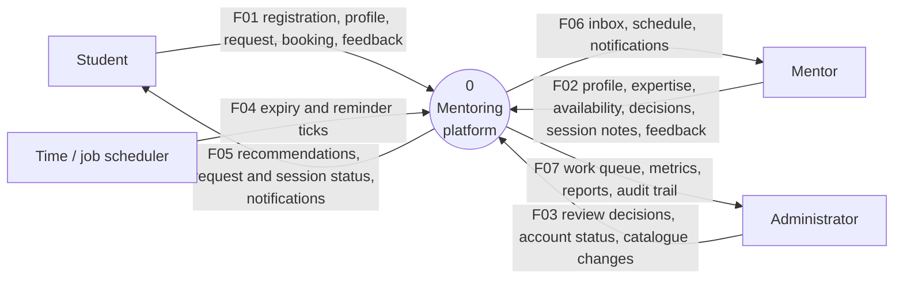

### External entities

| ID | Entity | Enters the system as | Leaves the system as | Frequency |
| --- | --- | --- | --- | --- |
| E1 | Student | registration, profile, skills, requests, bookings, cancellations, feedback | mentor results, request outcomes, schedule, notifications | Daily during a mentoring cycle |
| E2 | Mentor | registration, professional profile, expertise, slots, accept/decline, completion, feedback | inbox, schedule, notifications, review outcome | Daily |
| E3 | Administrator | mentor decisions, account status changes, catalogue edits | review queue, stale requests, KPIs, CSV exports, audit log | Weekly + on demand |
| E4 | Job scheduler | periodic tick (no payload) | run summary (counts) | Every 10 min (dev) / cron (prod) |

---

## 3. Level 1 — processes

| ID | Process | Purpose | Inputs | Outputs |
| --- | --- | --- | --- | --- |
| **P1** | Identity & access | Register, authenticate, refresh, logout, reset password | credentials, refresh cookie | access token, session state, audit rows |
| **P2** | Profile management | Maintain student/mentor profiles and their skill/interest links | profile fields, catalogue selections | profile rows, link rows, completeness flag |
| **P3** | Catalogue administration | Create/update/deactivate skills and career interests | admin edits | catalogue rows |
| **P4** | Discovery & matching | Rank mentors for a student from profile, expertise, interests, availability | search text, filters, student profile | ranked mentor list with reasons |
| **P5** | Request lifecycle | Create, cancel, accept, decline, expire requests | request form, mentor decision, scheduler tick | request rows, notifications, audit |
| **P6** | Mentorship management | Create mentorship on acceptance; complete or end it | accepted request, end/complete command | mentorship rows, notifications |
| **P7** | Availability & scheduling | Publish slots, book/cancel/complete sessions, record notes | slot definitions, booking command | slot rows, session rows, notifications |
| **P8** | Feedback | Record and read post-session ratings | rating, comment | feedback rows |
| **P9** | Notification management | Persist in-app notifications and serve read state | event from any process | notification rows, unread count, notification page |
| **P10** | Administration & reporting | Reviews, suspensions, catalogue overrides, analytics, exports | admin commands, read queries | status changes, aggregates, CSV |
| **P11** | Scheduled maintenance | Expire stale requests, send session reminders | scheduler tick | request status changes, reminder rows |

P9 is drawn as a process because it has logic (deduplication of reminders, read-state rules), even though it is only ever called by other processes.

### Data stores

| ID | Store | Table | Grain | Primary key | Main access |
| --- | --- | --- | --- | --- | --- |
| D1 | Users | `users` | one person | `user_id` | P1, P10 write; all read |
| D2 | Student profiles | `student_profiles` | one per student | `student_profile_id` | P2 write; P4/P5 read |
| D3 | Mentor profiles | `mentor_profiles` | one per mentor | `mentor_profile_id` | P2/P10 write; P4/P5/P7 read |
| D4 | Skills | `skills` | one skill | `skill_id` | P3 write; P2/P4 read |
| D5 | Career interests | `career_interests` | one interest | `interest_id` | P3 write; P2/P4 read |
| D6 | Student skills | `student_skills` | student × skill | composite | P2 write; P4 read |
| D7 | Mentor expertise | `mentor_expertise` | mentor × skill | composite | P2 write; P4 read |
| D8 | Student interests | `student_interests` | student × interest | composite | P2 write; P4 read |
| D9 | Mentor interests | `mentor_interests` | mentor × interest | composite | P2 write; P4 read |
| D10 | Requests | `mentoring_requests` | one ask | `request_id` | P5/P11 write; P4/P6/P10 read |
| D11 | Mentorships | `mentorships` | one relationship | `mentorship_id` | P6 write; P7/P8/P10 read |
| D12 | Availability slots | `availability_slots` | one window | `slot_id` | P7 write; P4/P7 read |
| D13 | Sessions | `sessions` | one meeting | `session_id` | P7 write; P8/P11 read |
| D14 | Feedback | `feedback` | one rating | `feedback_id` | P8 write; P10 read |
| D15 | Notifications | `notifications` | one event per recipient | `notification_id` | all processes write; P9 reads |
| D16 | Audit log | `audit_logs` | one action | `audit_id` | P1/P2/P5/P6/P7/P10 write; P10 reads |
| D17 | Refresh tokens | `refresh_tokens` | one token | `token_id` | P1 only |

---

## 4. Level 1 — one diagram per process

Level 1 is drawn as **eleven small diagrams**, one per process, rather than one large diagram. Each shows a single process with all of its external entities and data stores, so every arrow has exactly one meaning and the layout stays readable when rendered. Process and store IDs are stable across all diagrams and match §3.

The Mermaid source for each diagram is a standalone file in [`diagrams/`](./diagrams) and is rendered to PNG for the README; `diagrams/README.md` is the index.

### 4.1 P1 · Identity and access

**Purpose.** Register, authenticate, refresh, log out and reset a password.

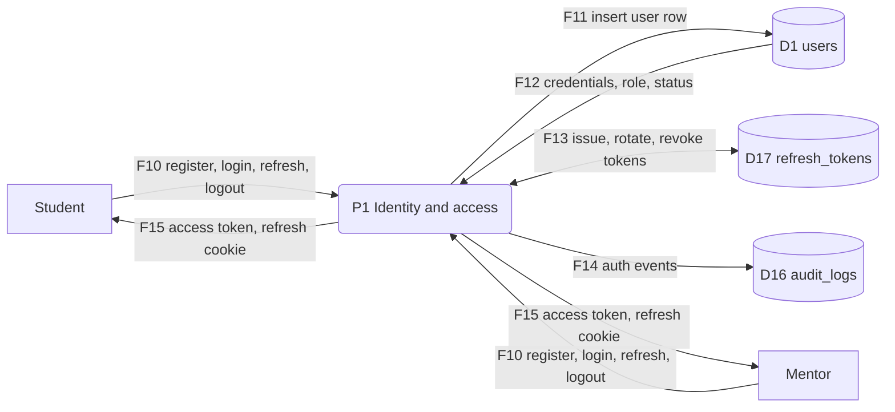

**Notes.** Registration writes D1 and returns an access token plus a rotating refresh token (D17). Login re-reads the password hash and `account_status`; a suspended account authenticates but is refused at authorisation. Every auth event is appended to D16, with a nullable actor for system actions.

### 4.2 P2 · Profile management

**Purpose.** Maintain student and mentor profiles plus their skill and interest links.

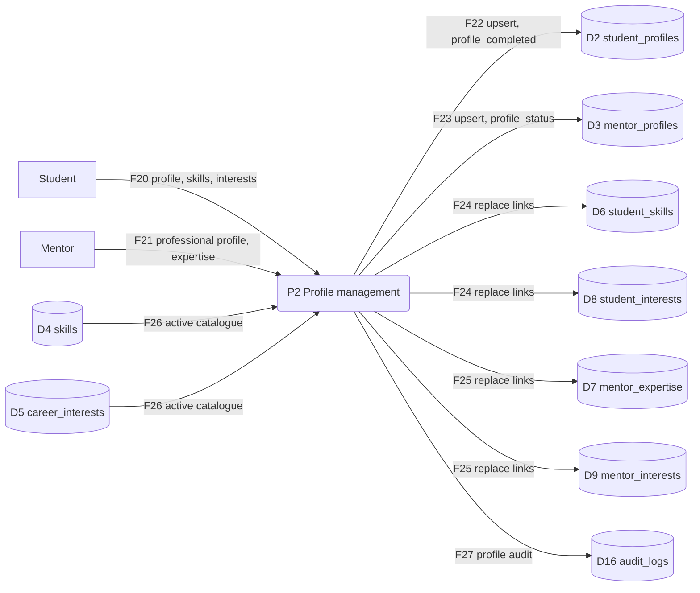

**Notes.** Skill and interest edits are replace-all: rows in D6–D9 are deleted and reinserted in one transaction, so the link tables always mirror the submitted form. `profile_completed` flips when the required fields and at least one skill or interest exist. A mentor submit moves `profile_status` to `pending_review`.

### 4.3 P3 · Catalogue administration

**Purpose.** Curate the controlled vocabularies that both sides of the marketplace select from.

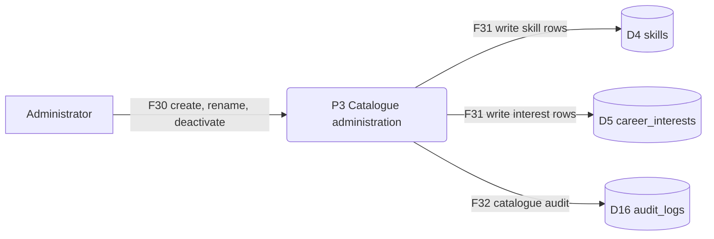

**Notes.** Catalogue rows are never hard-deleted: `is_active=false` retires a skill or interest while historical links in D6–D9 keep resolving. Each change writes an audit row with the before/after payload.

### 4.4 P4 · Discovery and matching

**Purpose.** Rank discoverable mentors for a student and explain why each one matched.

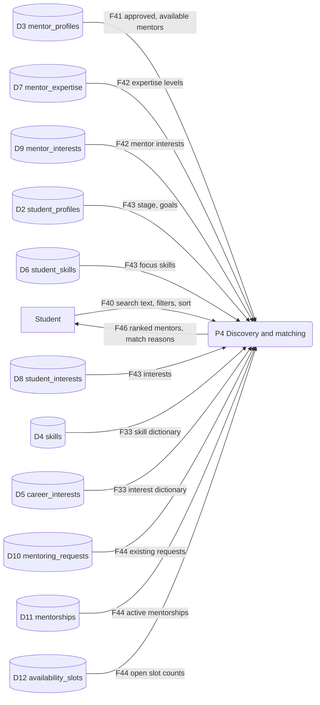

**Notes.** Read-only. Only `approved` mentors with `is_available=true` enter scoring; the score blends skill overlap, interest overlap, stage fit and open-slot count. The response carries match reasons so the UI can explain the ranking instead of showing a black-box list.

### 4.5 P5 · Request lifecycle

**Purpose.** Create, cancel, accept, decline and expire mentoring requests.

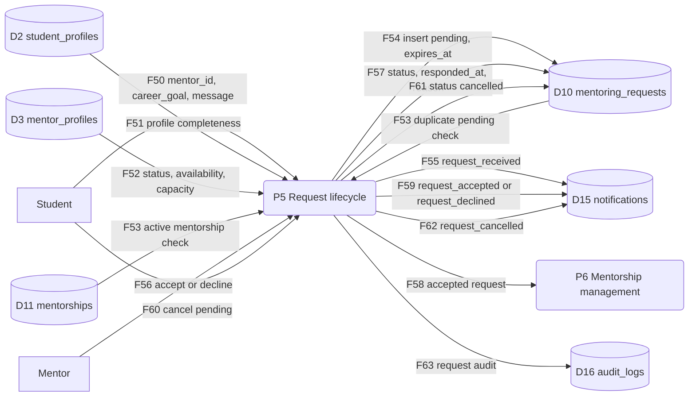

**Notes.** The service checks D2/D3 first, then relies on the partial unique indexes (`uq_pending_request`, `uq_active_pair`) so the same checks are race-proof. Acceptance emits F58 to P6 inside the same transaction; a failure leaves the request `pending`.

### 4.6 P6 · Mentorship management

**Purpose.** Create the mentorship on acceptance, then complete or end it.

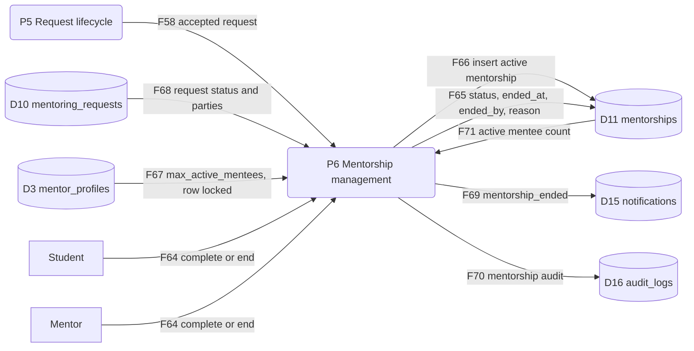

**Notes.** Insertion is guarded by `trg_mentorship_requires_accepted` and `trg_mentorship_capacity`; the service takes `FOR UPDATE` on the mentor profile first. Completion and ending both set `ended_at`, so `ck_mentorship_ended` stays satisfied, and both notify the counterpart.

### 4.7 P7 · Availability and scheduling

**Purpose.** Publish availability, book sessions, record notes, cancel and complete.

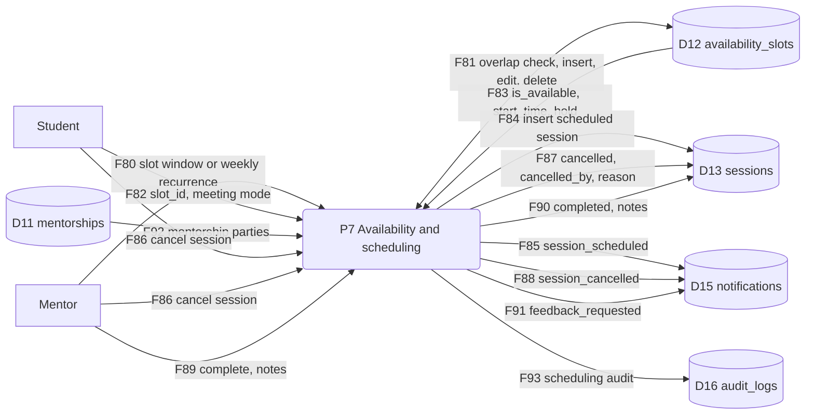

**Notes.** Slot writes are protected by `ex_slot_no_overlap`, bookings by the two partial GiST exclusion constraints. A slot is held when a `scheduled` session references it (`uq_session_slot_booked`), so booking never mutates `is_available`; cancelling frees the window automatically.

### 4.8 P8 · Feedback

**Purpose.** Record and read post-session ratings from both participants.

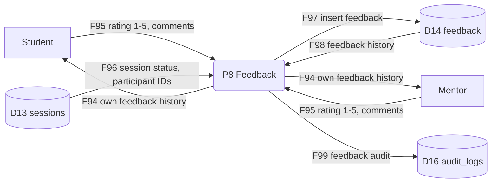

**Notes.** One rating per participant per session (`uq_feedback_once`). The service verifies the submitter is a party to a `completed` session; the database cannot express that rule, so it is a service check rather than a constraint.

### 4.9 P9 · Notification management

**Purpose.** Persist in-app events and serve the notification page.

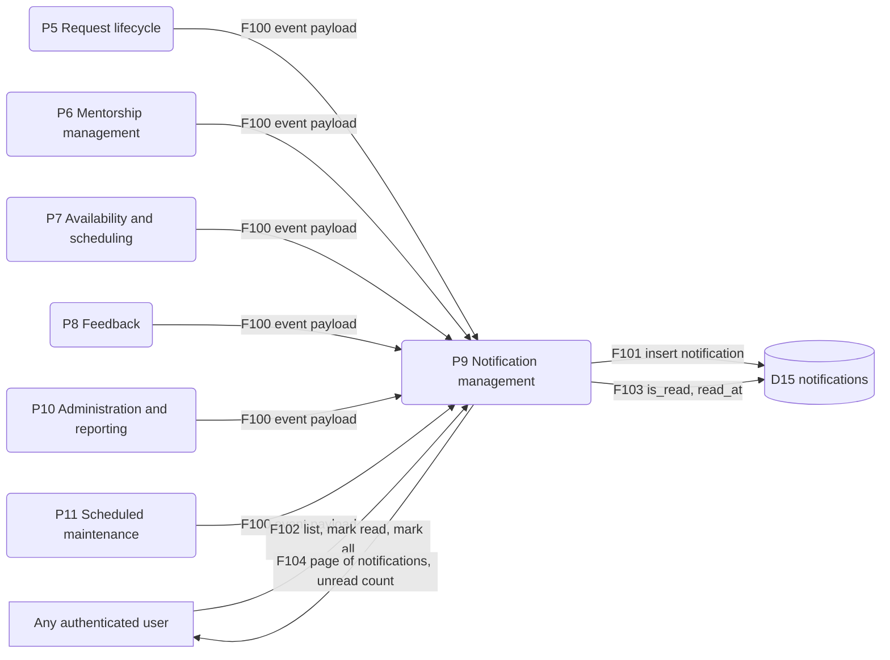

**Notes.** Every other process calls the notification service with one of twelve typed events; P9 persists one row per recipient. Read state is one-way: `is_read` and `read_at` move together, enforced by `ck_notification_read`.

### 4.10 P10 · Administration and reporting

**Purpose.** Review mentors, change account status, curate catalogues, report and export.

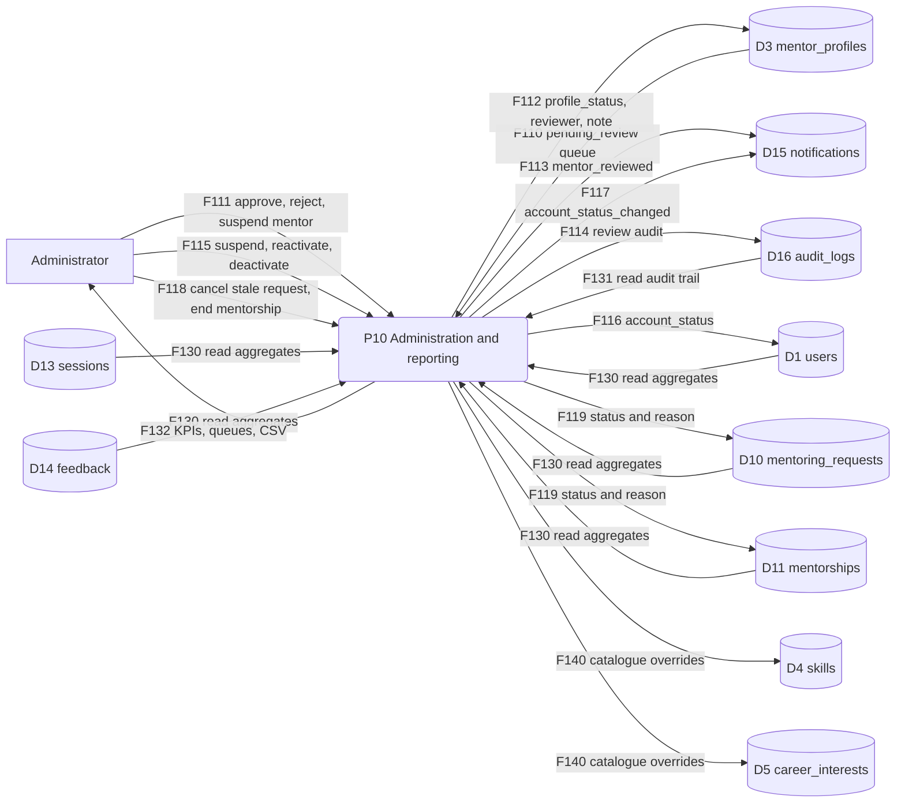

**Notes.** Review decisions require a reviewer and timestamp (`ck_mentor_reviewed`). Reporting is read-only and runs against D1/D10/D11/D13/D14; an export streams the same query result as CSV, so dashboard and export never disagree.

### 4.11 P11 · Scheduled maintenance

**Purpose.** Expire stale requests and remind participants about imminent sessions.

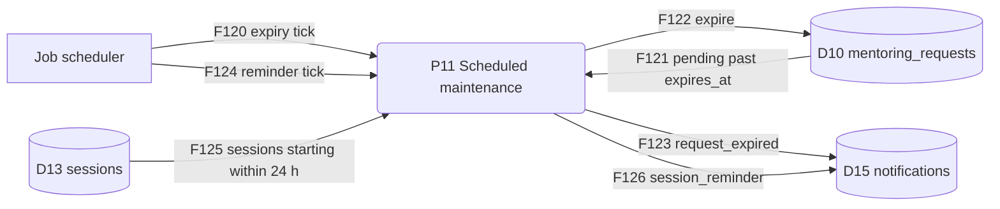

**Notes.** Both jobs are idempotent: expiry filters `status='pending'`, reminders check for an existing `session_reminder` for that user and session. A second tick in the same window therefore writes nothing.

---
## 5. Level 2 — request lifecycle (P5)

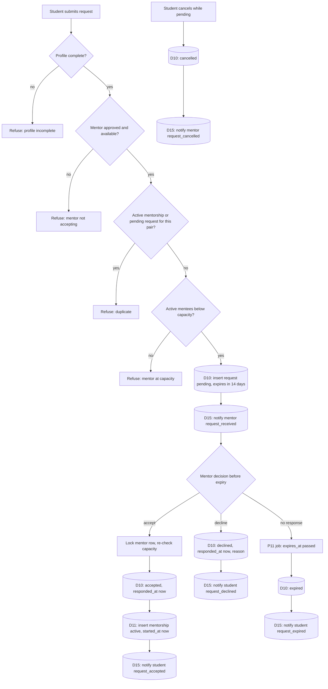

**Notes.**
- The capacity and duplicate checks are service-side reads; the database repeats them (`uq_pending_request`, `uq_active_pair`, capacity trigger) so concurrent accepts cannot oversubscribe.
- Acceptance and mentorship creation happen in one transaction; a failure leaves the request `pending`.
- No process edits `career_goal` after submission; a change requires cancelling and re-requesting.

---

## 6. Level 2 — availability and booking (P7)

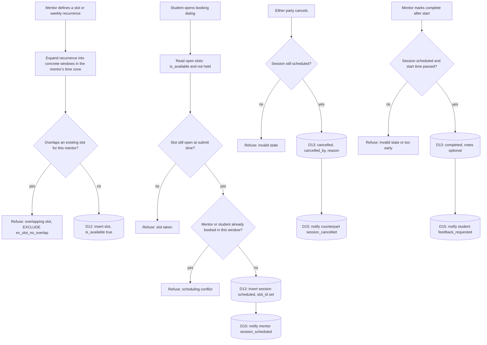

**Derived rule.** A slot is bookable when `is_available = true`, `start_time > now()`, and no `scheduled` session references it. Booking does not mutate `is_available`; the hold is derived from `sessions`. Cancelling frees the window automatically because the exclusion index only covers `scheduled` rows.

---

## 7. Flow catalogue

Every arrow in §2–§4 appears here with its payload. This table is the machine-readable version of the diagrams.

| ID | From → To | Data carried | Trigger | Frequency |
| --- | --- | --- | --- | --- |
| F01 | Student → system | registration fields, profile, skills, interests, request, booking, feedback | user action | daily |
| F02 | Mentor → system | registration, professional profile, expertise, slots, decisions, notes, feedback | user action | daily |
| F03 | Admin → system | review decision, account status, catalogue edit | admin action | weekly / ad hoc |
| F04 | Scheduler → system | tick (no payload) | timer | 10 min |
| F05 | System → Student | ranked mentors, request/session status, notifications | reads and events | on demand |
| F06 | System → Mentor | inbox, schedule, notifications | reads and events | on demand |
| F07 | System → Admin | queue, KPI aggregates, CSV, audit rows | admin action | ad hoc |
| F10 | Student/Mentor → P1 | name, email, password, role; login credentials | registration / login | daily |
| F11 | P1 → D1 | new user row | registration | per user |
| F12 | P1 ↔ D1 | credential hash, account_status, role | login / refresh | per request |
| F13 | P1 ↔ D17 | token hash, family_id, expiry, revocation | login / refresh / logout | per session |
| F14 | P1 → D16 | login, logout, failed attempt, password change | auth event | per event |
| F15 | P1 → user | access token, refresh cookie, identity | login / refresh | per session |
| F20 | Student → P2 | stage, graduation year, goals, guidance needs, bio, skill/interest selections | onboarding / edit | per edit |
| F21 | Mentor → P2 | type, title, organisation, experience, graduation, LinkedIn, bio, expertise, interests | onboarding / edit | per edit |
| F22 | P2 → D2 | student profile upsert, profile_completed | profile save | per edit |
| F23 | P2 → D3 | mentor profile upsert, profile_status | profile save / submit | per edit |
| F24 | P2 → D6/D8 | student skill rows (level, focus), interest rows | profile save | per edit |
| F25 | P2 → D7/D9 | expertise rows, mentor interest rows | profile save | per edit |
| F26 | P2 ↔ D4/D5 | active catalogue entries for pickers | profile form load | per load |
| F27 | P2 → D16 | profile change audit | profile save | per edit |
| F30 | Admin → P3 | skill/interest create, rename, deactivate | admin action | ad hoc |
| F31 | P3 → D4/D5 | catalogue rows | admin action | ad hoc |
| F32 | P3 → D16 | catalogue audit | admin action | ad hoc |
| F33 | D4/D5 → P2/P4 | skill and interest dictionaries | page load | per load |
| F40 | Student → P4 | query text, skill/interest/availability filters, sort | search / recommendation | per view |
| F41 | P4 ↔ D3 | approved + available mentors, FTS match, capacity | discovery query | per view |
| F42 | P4 ↔ D7/D9 | expertise levels, mentor interests | scoring | per view |
| F43 | P4 ↔ D2/D6/D8 | student stage, goals, focus skills, interests | scoring | per view |
| F44 | P4 ↔ D10/D11/D12 | existing requests, active mentorships, open slot count | filtering and badges | per view |
| F46 | P4 → Student | ranked mentor cards, match reasons, availability | response | per view |
| F50 | Student → P5 | mentor_id, career_goal, message | submit request | per request |
| F51 | P5 ↔ D2 | profile completeness, role | validation | per request |
| F52 | P5 ↔ D3 | profile_status, is_available, max_active_mentees | validation | per request |
| F53 | P5 ↔ D10/D11 | duplicate pending, active mentorship, capacity count | validation | per request |
| F54 | P5 → D10 | request row (pending, expires_at) | submit | per request |
| F55 | P5 → D15 | request_received event | submit | per request |
| F56 | Mentor → P5 | accept / decline, optional reason | decision | per request |
| F57 | P5 → D10 | status, responded_at, status_reason | decision | per request |
| F58 | P5 → P6 | accepted request (party IDs, request_id) | acceptance | per request |
| F59 | P5 → D15 | request_accepted / request_declined | decision | per request |
| F60 | Student → P5 | cancel command, optional reason | cancellation | per request |
| F61 | P5 → D10 | status cancelled | cancellation | per request |
| F62 | P5 → D15 | request_cancelled | cancellation | per request |
| F63 | P5 → D16 | request audit (create, accept, decline, cancel) | state change | per request |
| F64 | Student/Mentor → P6 | complete or end command, optional reason | mentoring relationship ends | per mentorship |
| F65 | P6 → D11 | status completed/ended, ended_at, ended_by, end_reason | complete / end | per mentorship |
| F66 | P6 → D11 | mentorship row (active, started_at) | acceptance | per request |
| F67 | P6 ↔ D3 | max_active_mentees (row locked) | capacity guard | per acceptance |
| F68 | P6 ↔ D10 | request status and parties | creation check | per acceptance |
| F69 | P6 → D15 | mentorship_ended | complete / end | per mentorship |
| F70 | P6 → D16 | mentorship audit | complete / end | per mentorship |
| F71 | P6 ↔ D11 | active mentee count for the mentor | capacity guard | per acceptance |
| F80 | Mentor → P7 | slot date/time or recurrence rule, time zone | slot create/edit/delete | weekly |
| F81 | P7 ↔ D12 | slot rows, overlap check | slot write | weekly |
| F82 | Student → P7 | slot_id, meeting mode, link | booking | per session |
| F83 | P7 ↔ D12 | is_available, start_time, held-by-session | booking check | per session |
| F84 | P7 → D13 | session row (scheduled, times from slot) | booking | per session |
| F85 | P7 → D15 | session_scheduled | booking | per session |
| F86 | Student/Mentor → P7 | cancel command, reason | cancellation | per session |
| F87 | P7 → D13 | status cancelled, cancelled_by, reason | cancellation | per session |
| F88 | P7 → D15 | session_cancelled | cancellation | per session |
| F89 | Mentor → P7 | complete command, notes | after start | per session |
| F90 | P7 → D13 | status completed, notes | completion | per session |
| F91 | P7 → D15 | feedback_requested | completion | per session |
| F92 | P7 ↔ D11 | mentorship parties | booking authorization | per session |
| F93 | P7 → D16 | scheduling audit (book, cancel, complete) | state change | per session |
| F94 | P8 → Student/Mentor | own feedback history | page load | per view |
| F95 | Student/Mentor → P8 | rating 1–5, comments | feedback submit | per session |
| F96 | P8 ↔ D13 | session status, participant IDs | validation | per feedback |
| F97 | P8 → D14 | feedback row | submit | per feedback |
| F98 | P8 ↔ D14 | feedback history for a session/mentor | page load | per view |
| F99 | P8 → D16 | feedback audit | submit | per feedback |
| F100 | P5/P6/P7/P8/P10/P11 → P9 | recipient, title, body, type, related entity | event | per event |
| F101 | P9 → D15 | notification row | event | per event |
| F102 | User → P9 | list filter, mark read / mark all | page action | per view |
| F103 | P9 → D15 | is_read, read_at | read action | per event |
| F104 | P9 → User | page of notifications, unread count | response | per view |
| F110 | P10 ↔ D3 | pending_review queue, profile detail | review page | per review |
| F111 | Admin → P10 | approve / reject / suspend, note | decision | per review |
| F112 | P10 → D3 | profile_status, reviewed_by, reviewed_at, review_note | decision | per review |
| F113 | P10 → D15 | mentor_reviewed | decision | per review |
| F114 | P10 → D16 | review audit | decision | per review |
| F115 | Admin → P10 | suspend / reactivate / deactivate user | admin action | ad hoc |
| F116 | P10 → D1 | account_status | admin action | ad hoc |
| F117 | P10 → D15 | account_status_changed | admin action | ad hoc |
| F118 | Admin → P10 | cancel stale request, end mentorship | admin action | ad hoc |
| F119 | P10 → D10/D11 | status and reason updates | admin action | ad hoc |
| F120 | Scheduler → P11 | tick | timer | 10 min |
| F121 | P11 ↔ D10 | pending requests past expires_at | expiry job | 10 min |
| F122 | P11 → D10 | status expired | expiry job | per row |
| F123 | P11 → D15 | request_expired | expiry job | per row |
| F124 | Scheduler → P11 | tick | timer | 10 min |
| F125 | P11 ↔ D13 | scheduled sessions within 24 h | reminder job | 10 min |
| F126 | P11 → D15 | session_reminder (deduplicated per user/session) | reminder job | per session |
| F130 | P10 ↔ D1/D10/D11/D13/D14 | aggregates for KPIs and exports | reporting query | per view |
| F131 | P10 ↔ D16 | audit page queries | admin view | per view |
| F132 | P10 → Admin | KPI tiles, queue, CSV file | response | per view |
| F140 | P10 → D4/D5 | catalogue overrides | admin action | ad hoc |

---

## 8. CRUD matrix

`C` create · `R` read · `U` update · `D` delete (cascade counts as delete). Empty cell = no access.

| Process | D1 | D2 | D3 | D4 | D5 | D6 | D7 | D8 | D9 | D10 | D11 | D12 | D13 | D14 | D15 | D16 | D17 |
| --- | --- | --- | --- | --- | --- | --- | --- | --- | --- | --- | --- | --- | --- | --- | --- | --- | --- |
| P1 Identity | C R U | | | | | | | | | | | | | | | C | C R U |
| P2 Profiles | R | C R U | C R U | R | R | C R D | C R D | C R D | C R D | | | | | | | C | |
| P3 Catalogue | | | | C R U | C R U | | | | | | | | | | | C | |
| P4 Discovery | | R | R | R | R | R | R | R | R | R | R | R | | | | | |
| P5 Requests | | R | R | | | | | | | C R U | R | | | | C | C | |
| P6 Mentorship | | | R | | | | | | | R | C R U | | | | C | C | |
| P7 Scheduling | | | | | | | | | | | R | C R U D | C R U | | C | C | |
| P8 Feedback | | | | | | | | | | | | | R | C R | C | C | |
| P9 Notifications | | | | | | | | | | | | | | | C R U | | |
| P10 Administration | R U | R | R U | C R U | C R U | R | R | R | R | R U | R U | | R | R | C | C R | |
| P11 Maintenance | | | | | | | | | | R U | | | R | | C | | |

Notes:
- P7's `D` on D12 is a hard delete of an unbooked slot; booked slots are hidden with `is_available=false` rather than deleted.
- No process deletes from D1–D3, D6–D14; lifecycle is expressed by status columns.
- D16 is append-only for application roles; only retention jobs (outside this DFD) remove old rows.

---

## 9. Consistency rules the DFD depends on

| Rule | Consequence if violated |
| --- | --- |
| `mentoring_requests.student_id` / `mentor_id` are **user IDs** | A DFD join or chart that uses profile IDs returns zero rows |
| A request reaches a terminal state exactly once | Funnel counts would double-count if statuses were overwritten |
| Cancelled sessions are excluded from overlap checks | A rebooking would be wrongly refused |
| A slot may hold at most one scheduled session | Double-booking; calendar and capacity charts diverge |
| Notifications are per recipient, not per event | Unread badge and engagement charts would be wrong |
| `reviewed_by` is mandatory once a mentor leaves draft | Approval-latency charts need a reviewer timestamp |
| Expiry job is idempotent | A second tick must not emit duplicate `request_expired` events (filter is `status='pending'`) |
| Reminder job deduplicates per user/session | Without the existence check, ticks every 10 min would spam users |

---

## 10. Regenerating the diagrams

Every block above is also stored as a standalone `.mmd` source in [`diagrams/`](./diagrams) and rendered to a PNG with Mermaid CLI 12. From the repository root:

```bash
# one diagram
npx -y @mermaid-js/mermaid-cli \
  -i docs/database/diagrams/dfd-p05-requests.mmd \
  -o docs/database/diagrams/dfd-p05-requests.png \
  --size 2200 -b white -s 2

# all of them (bash)
for f in docs/database/diagrams/*.mmd; do
  npx -y @mermaid-js/mermaid-cli -i "$f" -o "${f%.mmd}.png" --size 2200 -b white -s 2
done
```

Mermaid CLI 12 renamed `-w` to `--size`; `-s 2` renders at 2× device scale so the PNG stays sharp when zoomed. The PNGs are committed, so GitHub and the README work without a render step.

Mermaid does not have a native DFD shape set; the mapping used here is:

| DFD element | Mermaid construct |
| --- | --- |
| External entity | `S[Student]` rectangle |
| Process | `P1(P1 Identity and access)` rounded rectangle |
| Data store | `D1[(D1 users)]` cylinder |
| Flow | `-->|F10 payload|` labelled arrow |

The flow catalogue (§7) is sufficient to rebuild the diagrams in draw.io, Lucidchart or Graphviz if a different notation (Yourdon/DeMarco, Gane–Sarson) is required.

---

*Last verified against `database/schema.sql` on 2026-10-31.*
