# Diagram Index

Rendered diagrams for the database documentation. Every `.png` has a `.mmd` source next to it; the source is the file to edit, the PNG is the committed artifact.

All PNGs are rendered at `--size 2200 -s 2` (2× device scale) on a white background, so they stay sharp when opened full size.

---

## Entity–relationship diagram

[](erd.png)

| File | Shows |
| --- | --- |
| [`erd.mmd`](./erd.mmd) · [`erd.png`](./erd.png) | All 17 tables, their columns, primary/foreign keys and cardinalities. Companion to `DATABASE-SPEC.md` §6. |

---

## Data flow diagrams

### Level 0 — context

[](dfd-level0.png)

| File | Shows |
| --- | --- |
| [`dfd-level0.mmd`](./dfd-level0.mmd) · [`dfd-level0.png`](./dfd-level0.png) | The platform as one process, with students, mentors, administrators and the job scheduler outside the boundary. |

### Level 1 — one diagram per process

| Process | Diagram |
| --- | --- |
| **P1** Identity and access | [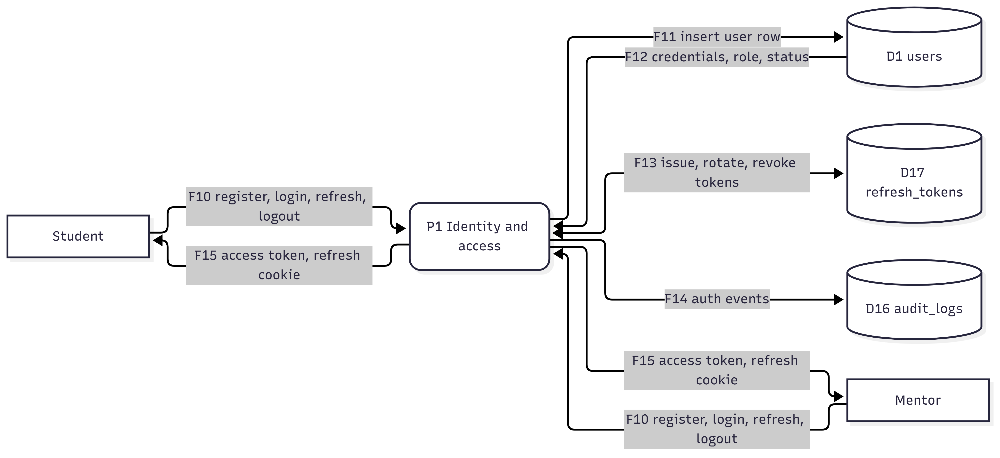](dfd-p01-identity.png) |
| **P2** Profile management | [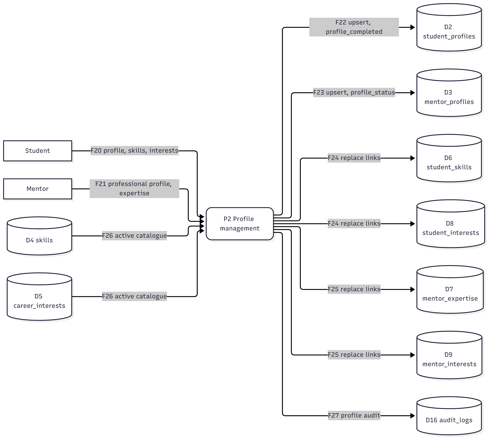](dfd-p02-profiles.png) |
| **P3** Catalogue administration | [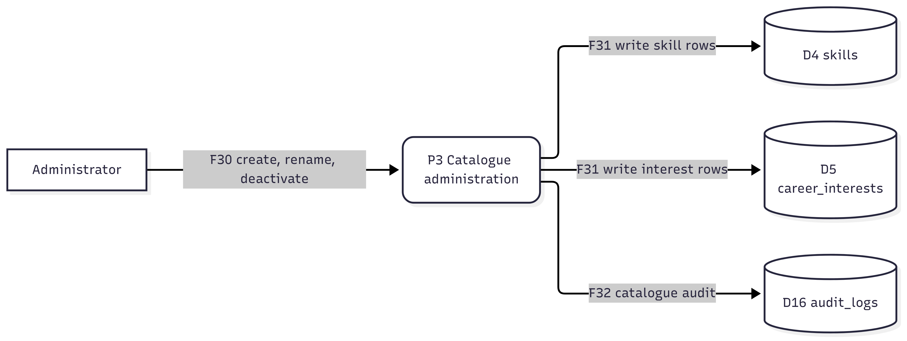](dfd-p03-catalogue.png) |
| **P4** Discovery and matching | [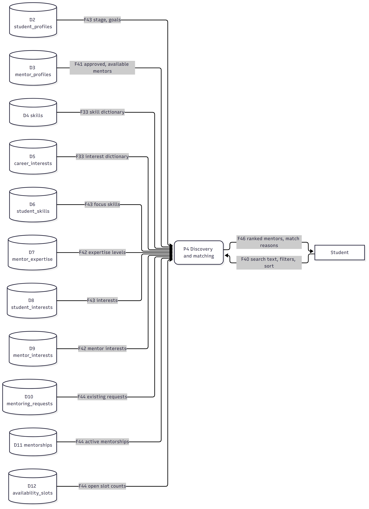](dfd-p04-discovery.png) |
| **P5** Request lifecycle | [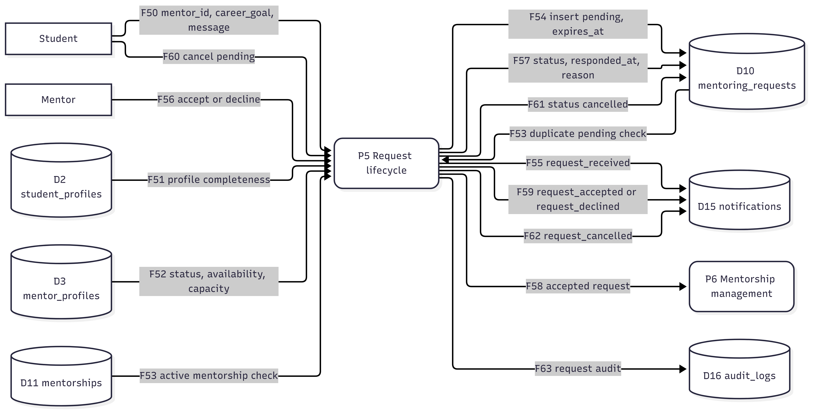](dfd-p05-requests.png) |
| **P6** Mentorship management | [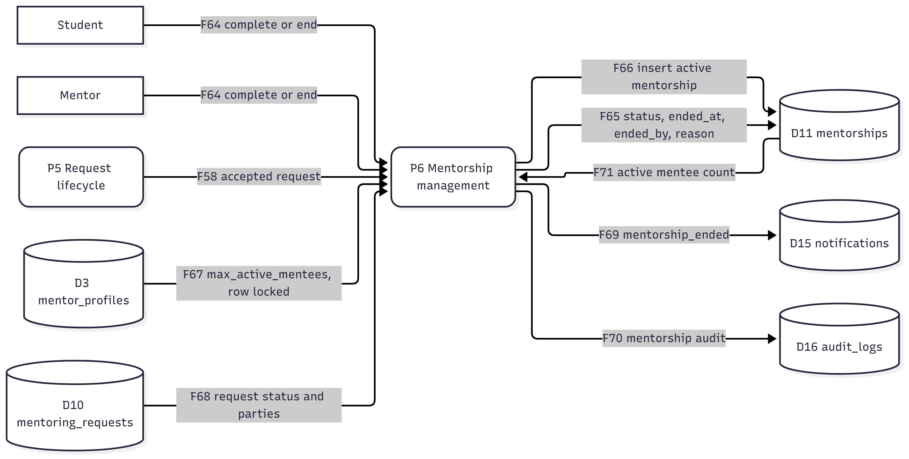](dfd-p06-mentorship.png) |
| **P7** Availability and scheduling | [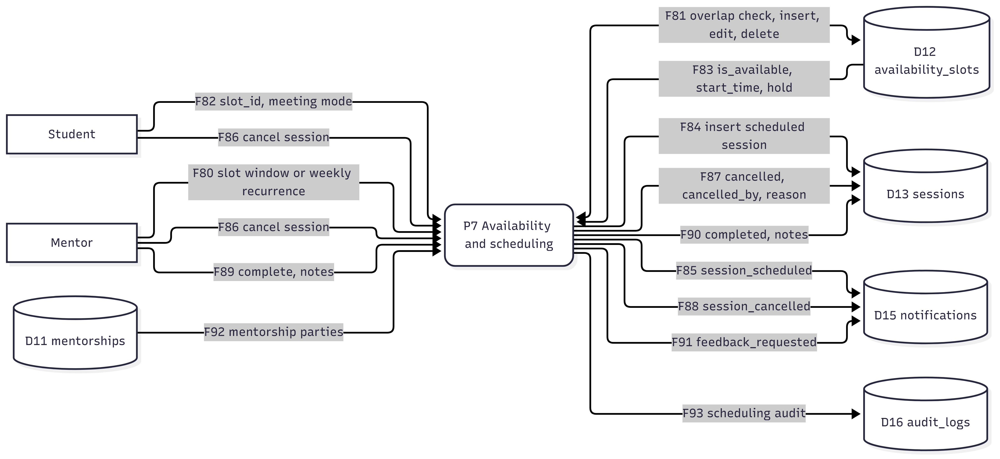](dfd-p07-scheduling.png) |
| **P8** Feedback | [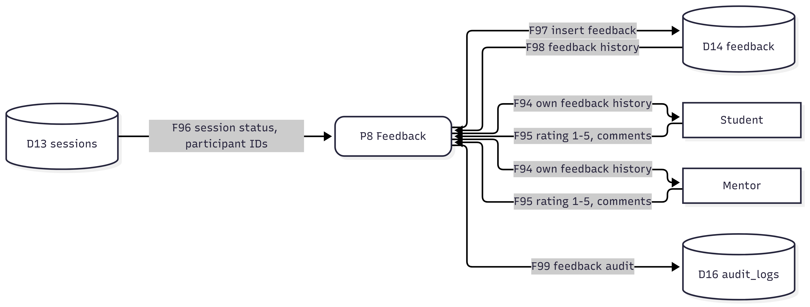](dfd-p08-feedback.png) |
| **P9** Notification management | [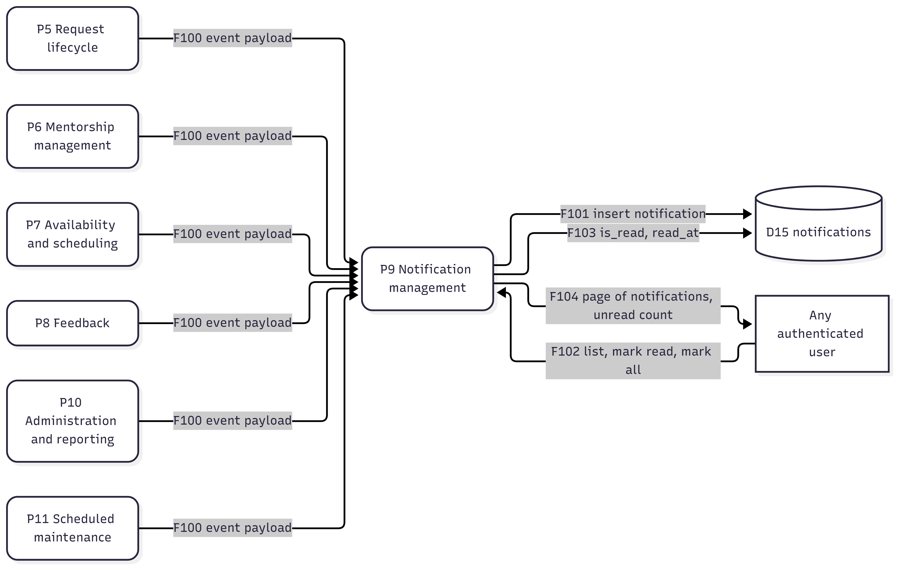](dfd-p09-notifications.png) |
| **P10** Administration and reporting | [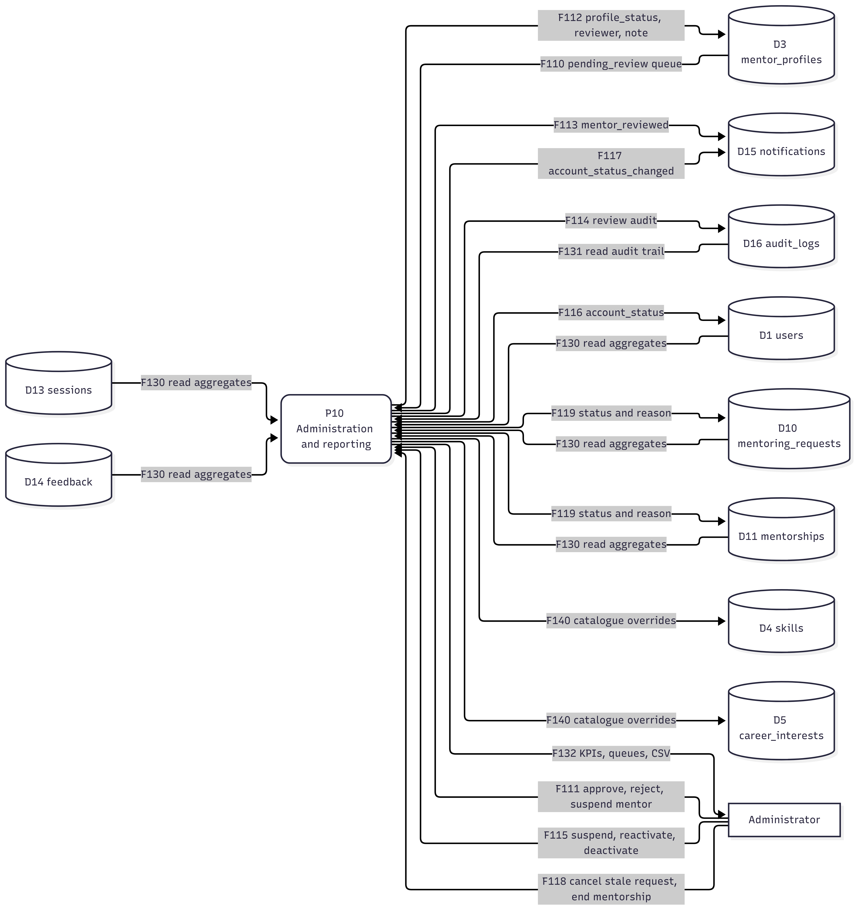](dfd-p10-admin.png) |
| **P11** Scheduled maintenance | [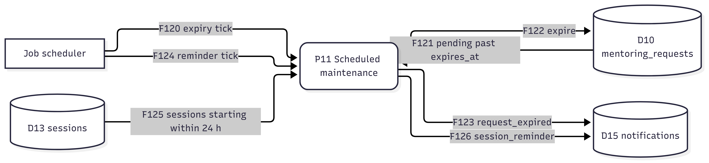](dfd-p11-maintenance.png) |

### Level 2 — branching processes

| Process | Diagram |
| --- | --- |
| **P5** Request lifecycle, decision branches | [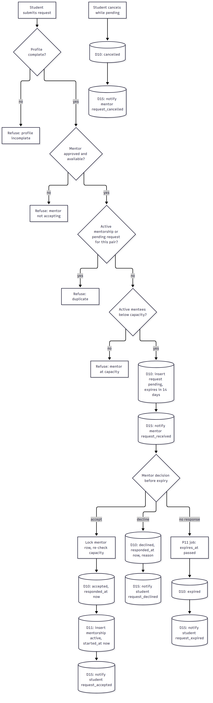](dfd-level2-requests.png) |
| **P7** Availability and booking, decision branches | [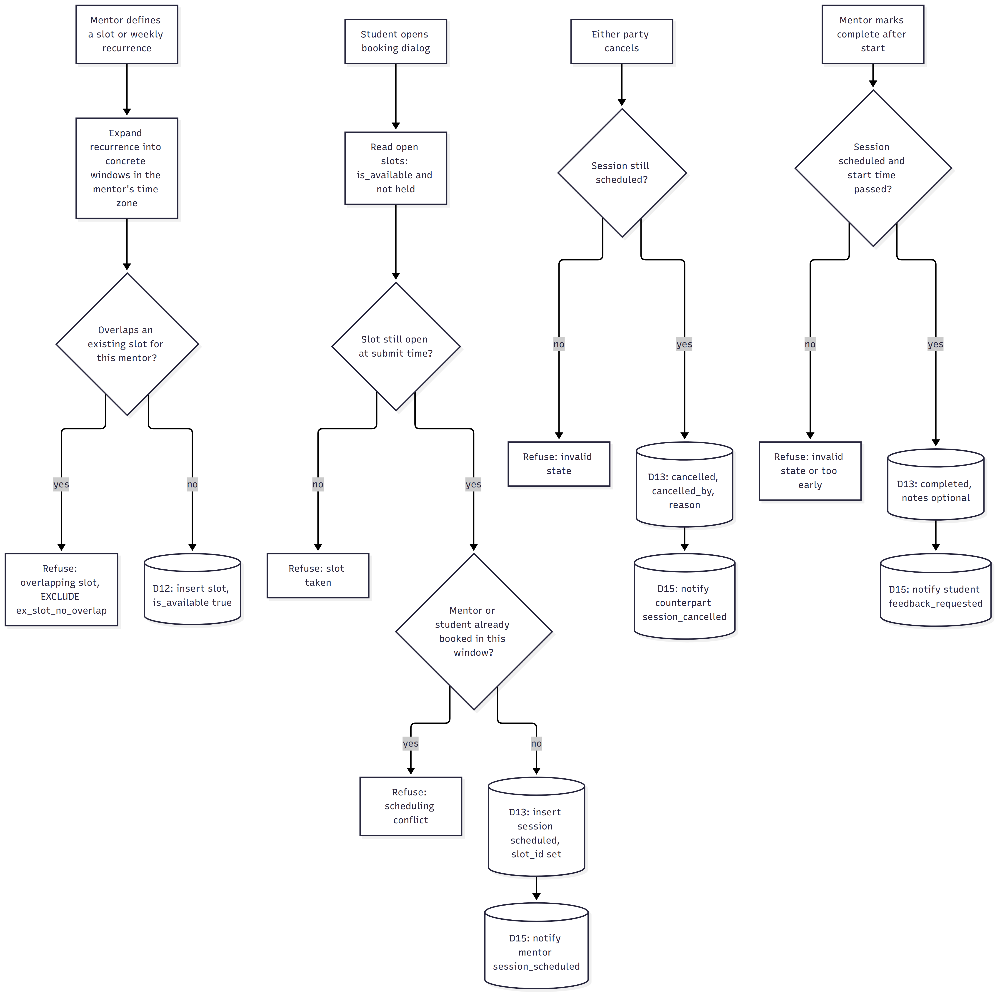](dfd-level2-scheduling.png) |

---

## Regenerate

From the repository root:

```bash
# one diagram
npx -y @mermaid-js/mermaid-cli \
  -i docs/database/diagrams/dfd-p05-requests.mmd \
  -o docs/database/diagrams/dfd-p05-requests.png \
  --size 2200 -b white -s 2

# every diagram (bash)
for f in docs/database/diagrams/*.mmd; do
  npx -y @mermaid-js/mermaid-cli -i "$f" -o "${f%.mmd}.png" --size 2200 -b white -s 2
done
```

On Windows PowerShell:

```powershell
Get-ChildItem docs/database/diagrams/*.mmd | ForEach-Object {
  $out = $_.FullName -replace '\.mmd$', '.png'
  npx -y @mermaid-js/mermaid-cli -i $_.FullName -o $out --size 2200 -b white -s 2
}
```

Mermaid CLI 12 renamed the old `-w/--width` flag to `--size`. There is no Graphviz or PlantUML dependency: the only requirement is Node.js and `npx`.

---

## Notation

| DFD element | Mermaid construct | Appearance |
| --- | --- | --- |
| External entity | `S[Student]` | rectangle |
| Process | `P1(P1 Identity and access)` | rounded rectangle |
| Data store | `D1[(D1 users)]` | cylinder |
| Flow | `-->|F10 payload|` | arrow with flow ID |

Flow IDs (`F01`–`F140`) are catalogued in [`../DFD.md`](../DFD.md) §7; data-store IDs (`D1`–`D17`) are catalogued in [`../DATABASE-SPEC.md`](../DATABASE-SPEC.md) §4 and [`../DFD.md`](../DFD.md) §3.

---

*Last rendered 2026-10-31 against `database/schema.sql`.*
